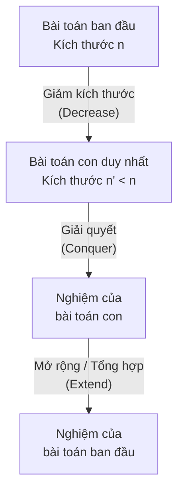
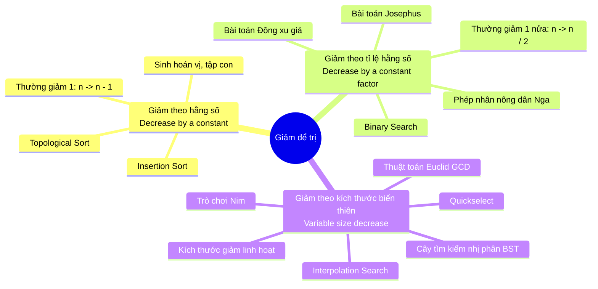

# CHUYÊN ĐỀ 00: TỔNG QUAN CHIẾN LƯỢC GIẢM ĐỂ TRỊ (DECREASE-AND-CONQUER)
*Tài liệu tham chiếu: A. Levitin, "Introduction to the Design and Analysis of Algorithms", 3rd Edition, Chương 4, Trang 131–134.*

---

## 1. TRIẾT LÝ VÀ BẢN CHẤT CHIẾN LƯỢC

Chiến lược **Giảm để trị (Decrease-and-Conquer)** là một kỹ thuật thiết kế thuật toán tổng quát và cực kỳ mạnh mẽ, dựa trên việc khai thác **mối quan hệ cấu trúc giữa nghiệm của một bài toán kích thước $n$ với nghiệm của một thể hiện con (sub-instance) có kích thước nhỏ hơn**.

### Hai phương thức triển khai cốt lõi:
1. **Tiếp cận từ trên xuống (Top-down - Đệ quy):**
   - Tự nhiên xuất phát từ công thức toán học hoặc định nghĩa đệ quy.
   - Gọi đệ quy để giải bài toán kích thước nhỏ hơn cho đến khi chạm trường hợp cơ sở (base case), sau đó quay lui để dựng nghiệm hoàn chỉnh.
   - *Ưu điểm:* Cú pháp trong sáng, biểu diễn trực tiếp tư tưởng toán học.
   - *Nhược điểm:* Chi phí quản lý ngăn xếp gọi hàm (call stack overhead), có nguy cơ tràn bộ nhớ nếu kích thước giảm chậm và $n$ quá lớn.

2. **Tiếp cận từ dưới lên (Bottom-up - Lặp):**
   - Bắt đầu giải bài toán từ thể hiện nhỏ nhất (trường hợp cơ sở $n=0$ hoặc $n=1$).
   - Sử dụng vòng lặp để mở rộng dần nghiệm từ kích thước nhỏ lên kích thước lớn hơn cho đến khi đạt kích thước $n$.
   - *Ưu điểm:* Không tốn bộ nhớ ngăn xếp đệ quy, tốc độ thực thi thường vượt trội so với đệ quy.

---

## 2. BA BIẾN THỂ CHÍNH CỦA GIẢM ĐỂ TRỊ

Theo phân loại kinh điển của Levitin, chiến lược Giảm để trị được chia thành ba biến thể chính tùy thuộc vào quy luật thu nhỏ kích thước của bài toán:

### 2.1. Giảm theo một hằng số (Decrease-by-a-Constant)
- Kích thước bài toán tại mỗi bước giảm đi một hằng số cố định $c$. Trong thực tế, phổ biến nhất là giảm 1 đơn vị ($c = 1$): kích thước giảm từ $n$ xuống $n - 1$.
- **Ví dụ toán học cơ sở:** Tính lũy thừa $a^n$ ($n$ nguyên không âm):
  $$a^n = \begin{cases} a^{n-1} \cdot a & \text{nếu } n > 0 \\ 1 & \text{nếu } n = 0 \end{cases}$$
- **Phương trình độ phức tạp điển hình:**
  $$T(n) = T(n - 1) + f(n)$$
  - Nếu công việc mở rộng $f(n) = \Theta(1) \implies T(n) = \Theta(n)$ (ví dụ: duyệt danh sách).
  - Nếu công việc mở rộng $f(n) = \Theta(n) \implies T(n) = \Theta(n^2)$ (ví dụ: Sắp xếp chèn - Insertion Sort).

### 2.2. Giảm theo một tỉ lệ hằng số (Decrease-by-a-Constant-Factor)
- Kích thước bài toán tại mỗi bước giảm đi một thừa số cố định $b > 1$. Phổ biến nhất là giảm đi một nửa ($b = 2$): kích thước giảm từ $n$ xuống $\lfloor n/2 \rfloor$.
- **Ví dụ toán học cơ sở:** Tính lũy thừa $a^n$ bằng phương pháp bình phương liên tiếp:
  $$a^n = \begin{cases} (a^{n/2})^2 & \text{nếu } n \text{ chẵn và } n > 0 \\ (a^{(n-1)/2})^2 \cdot a & \text{nếu } n \text{ lẻ} \\ 1 & \text{nếu } n = 0 \end{cases}$$
- **Phương trình độ phức tạp điển hình:**
  $$T(n) = T(n/b) + f(n)$$
  - Khi $f(n) = \Theta(1)$ (ví dụ Tìm kiếm nhị phân - Binary Search):
    $$T(n) = T(n/2) + \Theta(1) \implies T(n) = \Theta(\log n)$$
  - Kỹ thuật này đem lại bước nhảy vọt về tốc độ, chuyển đổi bài toán từ thời gian tuyến tính $\Theta(n)$ về thời gian logarit $\Theta(\log n)$.

### 2.3. Giảm theo kích thước biến thiên (Variable-Size-Decrease)
- Lượng giảm kích thước không cố định mà thay đổi linh hoạt sau mỗi bước lặp, phụ thuộc vào đặc thù của giá trị dữ liệu hoặc cấu trúc hiện tại.
- **Ví dụ toán học cơ sở:** Thuật toán Euclid tìm ước số chung lớn nhất $\gcd(m, n)$:
  $$\gcd(m, n) = \gcd(n, m \bmod n)$$
  Số bước giảm và độ lớn của $m \bmod n$ hoàn toàn biến thiên theo từng cặp số cụ thể.
- **Các thuật toán tiêu biểu:**
  - **Quickselect:** Kích thước mảng con phụ thuộc vào vị trí của phần tử chốt (pivot) sau khi phân hoạch.
  - **Interpolation Search:** Kích thước khoảng tìm kiếm giảm phụ thuộc vào giá trị nội suy.
  - **Thao tác trên cây BST:** Kích thước cây con phụ thuộc vào độ cân bằng và độ cao của từng nhánh.

---

## 3. SO SÁNH GIẢM ĐỂ TRỊ VỚI CÁC CHIẾN LƯỢC LIÊN CẬN

Nhiều tài liệu thường nhầm lẫn giữa **Giảm để trị (Decrease-and-Conquer)** và **Chia để trị (Divide-and-Conquer)**. Bảng so sánh dưới đây phân định ranh giới một cách tường minh:

| Tiêu chí | Giảm để trị (Decrease-and-Conquer) | Chia để trị (Divide-and-Conquer) | Quy hoạch động (Dynamic Programming) |
| :--- | :--- | :--- | :--- |
| **Số lượng bài toán con** | **Đúng 1** bài toán con duy nhất tại mỗi bước. | **Từ 2** bài toán con độc lập trở lên ($a \ge 2$). | Nhiều bài toán con gối nhau (overlapping subproblems). |
| **Cơ chế chia** | Loại bỏ một phần kích thước (bỏ $1$ phần tử hoặc bỏ $1/2$ mảng). | Chia toàn bộ dữ liệu thành các phần riêng biệt để giải tất cả. | Chia thành các trạng thái con và lưu bảng để tái sử dụng. |
| **Giai đoạn tổng hợp** | Đơn giản: mở rộng nghiệm của 1 bài toán con (ví dụ: chèn thêm 1 phần tử). | Phức tạp: trộn/hợp nhất nghiệm từ nhiều bài toán con độc lập. | Tối ưu hóa: so sánh và chọn nghiệm tốt nhất theo nguyên lý Bellman. |
| **Thuật toán đại diện** | Binary Search, Insertion Sort, Quickselect. | Merge Sort, Quicksort, Strassen. | Dãy con tăng dài nhất, Ba lô 0/1, Floyd-Warshall. |

> [!TIP]
> **Quy tắc vàng phân biệt:** Nếu sau bước phân rã, thuật toán chỉ cần gọi đệ quy (hoặc xét tiếp) trên **MỘT** bài toán con duy nhất thì đó chắc chắn là **Giảm để trị**. Nếu phải giải quyết từ hai bài toán con trở lên thì đó là **Chia để trị**.
