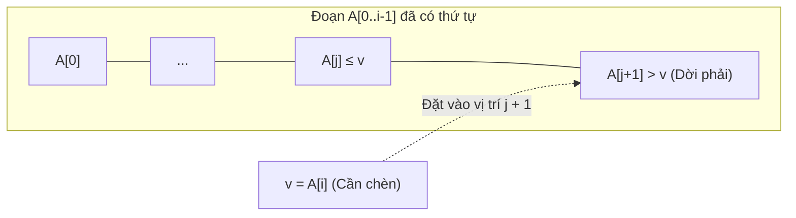

# CHUYÊN ĐỀ 01: SẮP XẾP CHÈN (INSERTION SORT) & LỜI GIẢI BÀI TẬP 4.1
*Tài liệu tham chiếu: A. Levitin, "Introduction to the Design and Analysis of Algorithms", 3rd Edition, Chương 4, Mục 4.1, Trang 134–138.*

---

## PHẦN I. LÝ THUYẾT VÀ MÃ GIẢ CHUẨN HÓA

### 1.1. Phát biểu bài toán hình thức
- **Đầu vào:** Mảng $A[0..n-1]$ gồm $n$ phần tử có thể so sánh được với quan hệ thứ tự toàn phần $\le$.
- **Đầu ra:** Mảng $A[0..n-1]$ đã được hoán vị sao cho:
  $$A[0] \le A[1] \le A[2] \le \dots \le A[n-1]$$

### 1.2. Bản chất ý tưởng thiết kế (Chiến lược Giảm 1 - Decrease-by-one)
Sắp xếp chèn áp dụng hoàn hảo kỹ thuật **Giảm 1 từ dưới lên (Bottom-up)**:
1. Xét bài toán cơ sở: Mảng con $A[0..0]$ có kích thước bằng 1 luôn luôn đã có thứ tự.
2. Giả sử mảng con $A[0..i-1]$ (kích thước $i$) đã được sắp xếp tăng dần. Để giải quyết bài toán kích thước $i+1$ ($A[0..i]$), ta cần chèn phần tử $A[i]$ vào đúng vị trí của nó trong đoạn $A[0..i-1]$.
3. **Cơ chế chèn:** Quét từ phải sang trái (từ $j = i-1$ lùi dần về 0). Khi gặp phần tử $A[j] > A[i]$, ta dời $A[j]$ sang phải một vị trí ($A[j+1] \leftarrow A[j]$) để tạo khe trống. Vòng quét dừng lại ngay khi gặp phần tử đầu tiên $A[j] \le A[i]$ hoặc khi chạm đầu mảng ($j < 0$). Khi đó, ta đặt giá trị cần chèn vào vị trí $A[j+1]$.



### 1.3. Mã giả chuẩn hóa cấu trúc (Structured Pseudocode)

```text
Algorithm InsertionSort(A[0..n-1])
// Mô tả: Sắp xếp mảng theo thứ tự không giảm bằng thuật toán Sắp xếp chèn
// Đầu vào: Mảng A[0..n-1] gồm n phần tử có thể so sánh được
// Đầu ra: Mảng A[0..n-1] đã được sắp xếp tăng dần

1   for i ← 1 to n - 1 do
2       v ← A[i]             // Lưu trữ phần tử hiện tại cần chèn
3       j ← i - 1            // Bắt đầu quét từ vị trí ngay trước i
4       while j ≥ 0 and A[j] > v do
5           A[j + 1] ← A[j]  // Dời phần tử lớn hơn sang phải 1 vị trí
6           j ← j - 1        // Lùi tiếp về bên trái
7       A[j + 1] ← v         // Đặt giá trị v vào vị trí thích hợp đã tìm được
```

### 1.4. Phân tích toán học độ phức tạp

- **Phép toán cơ sở (Basic operation):** Phép so sánh khóa $A[j] > v$ trong điều kiện vòng lặp `while`.
- Kích thước đầu vào: Số lượng phần tử $n$.

#### 1.4.1. Trường hợp xấu nhất (Worst-case)
- Xảy ra khi mảng ban đầu được sắp xếp theo thứ tự **giảm ngặt**: $A[0] > A[1] > \dots > A[n-1]$.
- Khi đó, tại mỗi bước $i$, giá trị $v = A[i]$ luôn nhỏ hơn tất cả các phần tử đứng trước nó. Vòng lặp `while` phải so sánh đúng $i$ lần cho đến khi $j = -1$.
- Tổng số phép so sánh khóa:
  $$C_{worst}(n) = \sum_{i=1}^{n-1} \sum_{j=0}^{i-1} 1 = \sum_{i=1}^{n-1} i = \frac{n(n-1)}{2} \approx \frac{n^2}{2} \in \Theta(n^2)$$
- Số phép gán dữ liệu dịch chuyển: Mỗi lần so sánh đều đi kèm 1 phép dời mảng cộng thêm 2 phép gán ngoài vòng lặp (gán $v$ và ghi $v$), tổng số phép gán đạt xấp xỉ $\frac{n^2}{2}$.

#### 1.4.2. Trường hợp tốt nhất (Best-case)
- Xảy ra khi mảng ban đầu **đã được sắp xếp tăng dần sẵn**: $A[0] \le A[1] \le \dots \le A[n-1]$.
- Tại mỗi bước $i$, ngay lần kiểm tra đầu tiên với $j = i-1$, ta luôn có $A[i-1] \le v$. Vòng lặp `while` chỉ so sánh đúng 1 lần và lập tức kết thúc mà không thực hiện bất kỳ phép dời nào.
- Tổng số phép so sánh khóa:
  $$C_{best}(n) = \sum_{i=1}^{n-1} 1 = n - 1 \in \Theta(n)$$
- **Nhận xét quan trọng:** Đây là ưu thế vượt trội của Insertion Sort so với Selection Sort (luôn tốn $\Theta(n^2)$ trong mọi trường hợp).

#### 1.4.3. Trường hợp trung bình (Average-case)
- Giả thiết: Dữ liệu phân bố ngẫu nhiên đồng đều, tất cả $n!$ hoán vị của $n$ phần tử phân biệt đều có xác suất xuất hiện như nhau.
- Khi chèn $A[i]$ vào mảng con đã sắp có $i$ phần tử, giá trị $v$ có thể rơi vào $i+1$ vị trí có thể có với xác suất đồng đều là $\frac{1}{i+1}$.
- Số phép so sánh trung bình ở bước $i$ xấp xỉ $\frac{i}{2}$.
- Tổng số phép so sánh trung bình:
  $$C_{avg}(n) = \sum_{i=1}^{n-1} \frac{i}{2} = \frac{1}{2} \sum_{i=1}^{n-1} i = \frac{n(n-1)}{4} \approx \frac{n^2}{4} \in \Theta(n^2)$$
- **Kết luận:** Trong trường hợp trung bình, Insertion Sort chạy **nhanh gấp đôi** so với trường hợp xấu nhất!

#### 1.4.4. Độ phức tạp không gian bộ nhớ (Space Complexity)
- Thuật toán sắp xếp tại chỗ (**in-place**): Chỉ sử dụng thêm một vài biến vô hướng ($i, j, v$).
- Độ phức tạp không gian bổ sung: $S(n) \in \Theta(1)$.

#### 1.4.5. Tính ổn định (Stability)
- **Ổn định (Stable):** Điều kiện vòng lặp là $A[j] > v$ (chỉ dời khi phần tử đứng trước LỚN HƠN NGẶT). Nếu hai phần tử có giá trị bằng nhau ($A[j] = v$), vòng lặp `while` dừng lại và $v$ được đặt ngay sau $A[j]$, do đó bảo toàn tuyệt đối thứ tự xuất hiện ban đầu của các phần tử có cùng giá trị.

---

## PHẦN II. GIẢI CHI TIẾT 100% CÁC BÀI TẬP EXERCISES 4.1 (BÀI 1 ĐẾN BÀI 12)

---

### Bài 1 (Ferrying soldiers - Vận chuyển binh lính qua sông)
> **Đề bài:**  
> Một toán gồm $n$ người lính cần vượt qua một con sông rộng và sâu mà không có cầu. Họ thấy có hai cậu bé 12 tuổi đang chèo một chiếc thuyền nhỏ gần bờ. Chiếc thuyền rất bé, chỉ có thể chở tối đa: hoặc 2 cậu bé, hoặc 1 người lính (không thể chở 1 lính và 1 cậu bé cùng lúc).  
> Làm thế nào để tất cả $n$ người lính sang được bờ bên kia và để lại chiếc thuyền cho hai cậu bé cùng sở hữu? Cần tổng cộng bao nhiêu lượt thuyền qua lại giữa hai bờ sông?

#### Lời giải chi tiết:
Áp dụng chiến lược **Giảm 1 (Decrease-by-one)**: Ta thiết kế một chu kỳ chuyển quân sao cho đúng **1 người lính** qua sông an toàn, đồng thời đưa trạng thái thuyền và 2 cậu bé về lại bờ xuất phát.

Gọi Bờ A là bờ xuất phát, Bờ B là bờ đích đến.
- **Trạng thái ban đầu:** Bờ A có $n$ người lính và 2 cậu bé (Boy 1, Boy 2); Thuyền ở Bờ A.

**Chu kỳ 4 bước để chuyển 1 người lính:**
1. **Lượt 1 (A $\to$ B):** Hai cậu bé (Boy 1 và Boy 2) cùng lên thuyền chèo sang Bờ B.  
   *(Hiện tại: Bờ A có $n$ lính; Bờ B có 2 cậu bé; Thuyền ở B).*
2. **Lượt 2 (B $\to$ A):** Cậu bé Boy 1 ở lại Bờ B, Boy 2 chèo thuyền quay về Bờ A.  
   *(Hiện tại: Bờ A có $n$ lính, 1 cậu bé; Bờ B có 1 cậu bé; Thuyền ở A).*
3. **Lượt 3 (A $\to$ B):** Một người lính lên thuyền một mình chèo sang Bờ B.  
   *(Hiện tại: Bờ A có $n-1$ lính, 1 cậu bé; Bờ B có 1 lính, 1 cậu bé; Thuyền ở B).*
4. **Lượt 4 (B $\to$ A):** Cậu bé Boy 1 từ Bờ B lên thuyền chèo quay về Bờ A đón bạn.  
   *(Hiện tại: Bờ A có $n-1$ lính, 2 cậu bé; Bờ B có 1 lính; Thuyền ở A).*

**Kết quả sau 1 chu kỳ:**
- Kích thước bài toán giảm từ $n$ lính xuống $n - 1$ lính tại bờ A.
- Chiếc thuyền và cả 2 cậu bé lại cùng có mặt tại bờ A để sẵn sàng cho chu kỳ tiếp theo!

**Tính tổng số lượt thuyền:**
- Mỗi người lính qua sông cần đúng 4 lượt thuyền.
- Với $n$ người lính, tổng số lượt thuyền cần di chuyển qua lại là:
  $$T(n) = 4n \text{ lượt}$$
- Sau $4n$ lượt, toàn bộ $n$ người lính đã ở Bờ B, và ở lượt thứ $4n$, cậu bé Boy 1 chèo thuyền về lại Bờ A, sau đó 2 cậu bé vẫn giữ quyền sở hữu chiếc thuyền. (Nếu muốn cả 2 cậu bé sang Bờ B chơi cùng toán lính thì thêm 1 lượt cuối 2 cậu bé cùng chèo qua B, tổng là $4n+1$; nhưng theo đề bài "để lại thuyền cho 2 cậu bé", sau $4n$ lượt thì 2 cậu bé có thuyền tại bờ A hoặc B tùy ý).
- **Đáp số:** $4n$ lượt di chuyển thuyền.

---

### Bài 2 (Alternating glasses - Hoán vị cốc nước ngọt xen kẽ)
> **Đề bài:**  
> a. Có $2n$ chiếc cốc xếp thành một hàng ngang kề nhau. Trong đó $n$ chiếc cốc đầu tiên chứa đầy nước soda, và $n$ chiếc cốc tiếp theo rỗng. Hãy làm cho các cốc xen kẽ theo mẫu: đầy - rỗng - đầy - rỗng... với số lần di chuyển cốc ít nhất.  
> b. Giải bài toán tương tự nếu ban đầu $2n$ cốc ($n$ đầy, $n$ rỗng) nằm ở một thứ tự ngẫu nhiên bất kỳ.

#### Lời giải chi tiết:

#### Phần a:
- Dãy ban đầu gồm $2n$ vị trí (đánh số từ 1 đến $2n$):
  $$[Đ_1, Đ_2, Đ_3, \dots, Đ_n, R_1, R_2, R_3, \dots, R_n]$$
- Mục tiêu cần đạt: Các vị trí lẻ ($1, 3, 5, \dots, 2n-1$) phải là cốc ĐẦY, các vị trí chẵn ($2, 4, 6, \dots, 2n$) phải là cốc RỖNG.
- **Ý tưởng tối ưu:** Thay vì di chuyển thân cốc, ta **rót nước** từ cốc đầy này sang cốc rỗng khác!
  - Cốc đầy ở vị trí chẵn $2, 4, 6, \dots$ đang bị sai vị trí (lẽ ra phải là rỗng).
  - Cốc rỗng ở vị trí lẻ $n+1, n+3, \dots$ (hoặc các vị trí lẻ từ cuối về) đang bị sai vị trí (lẽ ra phải là đầy).
  - Ta lấy nước từ các cốc đầy ở vị trí chẵn rót vào các cốc rỗng ở vị trí lẻ cần làm đầy:
    - Rót từ cốc ở vị trí $2$ vào cốc ở vị trí $2n - 1$.
    - Rót từ cốc ở vị trí $4$ vào cốc ở vị trí $2n - 3$.
    - Tổng quát: Rót từ cốc ở vị trí $2k$ vào cốc ở vị trí $2n - 2k + 1$.
- **Số lần rót tối thiểu:** Đúng bằng số lượng cốc đầy ở vị trí chẵn cần làm rỗng, tức là:
  $$\text{Số bước} = \lfloor n/2 \rfloor$$
  *Ví dụ minh họa:*
  - Với $n = 3$ ($Đ Đ Đ R R R$): Rót từ cốc 2 sang cốc 5 $\implies$ thu được $Đ R Đ R Đ R$. Chỉ tốn $\lfloor 3/2 \rfloor = 1$ lần rót!
  - Với $n = 4$ ($Đ Đ Đ Đ R R R R$): Rót cốc 2 sang cốc 7, cốc 4 sang cốc 5 $\implies$ tốn $\lfloor 4/2 \rfloor = 2$ lần rót.

#### Phần b (Trật tự ban đầu ngẫu nhiên):
- Đếm số vị trí chẵn hiện đang chứa nước ($c_{even}$) và số vị trí lẻ hiện đang rỗng ($e_{odd}$). Vì tổng số cốc đầy luôn bằng $n$, ta luôn có $c_{even} = e_{odd}$.
- Số lần di chuyển/rót tối thiểu chính bằng số lượng phần tử bị lệch tính chẵn lẻ:
  $$\text{Số bước tối thiểu} = c_{even}$$
  Ta chỉ cần chọn lần lượt từng cốc đầy ở vị trí chẵn và rót vào một cốc rỗng ở vị trí lẻ.

---

### Bài 3 (Marking cells - Đánh dấu các ô trên lưới có số láng giềng lẻ)
> **Đề bài:**  
> Thiết kế một thuật toán thực hiện nhiệm vụ sau: Với mọi số nguyên dương chẵn $n$, hãy đánh dấu $n$ ô vuông trên một tờ giấy kẻ ô li vô hạn sao cho mỗi ô được đánh dấu có **số lượng ô láng giềng được đánh dấu là số lẻ** (tức là có đúng 1 hoặc đúng 3 ô láng giềng).  
> Hai ô được coi là láng giềng nếu chúng kề nhau theo chiều ngang hoặc chiều dọc (không tính đường chéo). Các ô được đánh dấu phải tạo thành một **vùng liên thông** (có đường đi giữa hai ô bất kỳ qua chuỗi các ô láng giềng được đánh dấu).

#### Lời giải chi tiết:
Áp dụng chiến lược **Giảm 2 (Decrease-by-2)** kết hợp Quy nạp toán học:

1. **Trường hợp cơ sở $n = 2$:**
   - Đánh dấu 2 ô kề nhau theo chiều ngang: $[(0, 0), (1, 0)]$.
   - Mỗi ô chỉ có đúng 1 láng giềng được đánh dấu (ô kia). Vì 1 là số lẻ, cấu hình này thỏa mãn tuyệt đối!

2. **Bước quy nạp / Mở rộng từ $n$ lên $n + 2$:**
   - Giả sử ta đã có một vùng liên thông gồm $n$ ô thỏa mãn tính chất: mỗi ô có số láng giềng lẻ, và tồn tại ít nhất một ô biên $X$ có đúng 1 láng giềng.
   - Để thêm 2 ô mới ($O_1, O_2$) mà không làm phá vỡ tính lẻ của các ô đã có:
     - Ta gắn một khối domino $1 \times 2$ gồm hai ô $O_1$ và $O_2$ kề nhau vào cạnh của ô $X$.
     - Đặt $O_1$ kề với $X$, và $O_2$ kề với $O_1$ sao cho $O_1$ chỉ tiếp xúc với $X$ và $O_2$ (không tiếp xúc với ô nào khác), còn $O_2$ chỉ tiếp xúc duy nhất với $O_1$.
     - Khi đó:
       - Số láng giềng của $X$ tăng thêm 1 (từ 1 thành 2? Như vậy $X$ sẽ có 2 láng giềng - là số chẵn, vi phạm!).
   - **Hiệu chỉnh giải pháp khuôn mẫu chuẩn (Dạng xương cá / dải chữ L):**
     - Cách đơn giản nhất: Xếp $n/2$ khối domino $1 \times 2$ thành hình bậc thang so le nhau (diagonal zigzag cascade):
       - Khối 1: $(0, 0)$ và $(0, 1)$ (hai ô kề dọc).
       - Khối 2: $(1, 1)$ và $(1, 2)$.
       - Khối $k$: $(k-1, k-1)$ và $(k-1, k)$.
     - Kiểm tra láng giềng:
       - Các ô đầu và cuối dải có đúng 1 láng giềng.
       - Các ô ở vị trí nối $(k-1, k)$ tiếp xúc với $(k-1, k-1)$, $(k, k)$ và không tiếp xúc thêm ô nào khác $\implies$ có đúng 3 láng giềng (hoặc bố trí sao cho mỗi ô có đúng 1 hoặc 3 láng giềng).
     - Vùng ô luôn liên thông và số ô luôn tăng thêm đúng 2 sau mỗi bước.

---

### Bài 4 (Power set - Sinh tập lũy thừa bằng Giảm 1)
> **Đề bài:**  
> Thiết kế một thuật toán Giảm 1 (Decrease-by-one) để sinh tập lũy thừa $\mathcal{P}(S)$ của một tập hợp $S$ gồm $n$ phần tử. ($\mathcal{P}(S)$ là tập hợp chứa tất cả các tập con của $S$, bao gồm cả tập rỗng $\emptyset$ và chính $S$).

#### Lời giải chi tiết:
- Ký hiệu tập hợp $S = \{a_1, a_2, \dots, a_n\}$.
- Bản chất quan hệ Giảm 1:
  - Gọi $S_{n-1} = \{a_1, a_2, \dots, a_{n-1}\}$.
  - Mọi tập con của $S$ thuộc vào một trong hai loại:
    1. Không chứa phần tử $a_n$: Đây chính là các phần tử của $\mathcal{P}(S_{n-1})$.
    2. Có chứa phần tử $a_n$: Thu được bằng cách lấy từng tập con trong $\mathcal{P}(S_{n-1})$ hợp thêm phần tử $\{a_n\}$.
  - Công thức đệ quy:
    $$\mathcal{P}(S_n) = \mathcal{P}(S_{n-1}) \cup \{ T \cup \{a_n\} \mid T \in \mathcal{P}(S_{n-1}) \}$$
  - Trường hợp cơ sở: Khi $n = 0$ ($S = \emptyset$), $\mathcal{P}(\emptyset) = \{\emptyset\}$.

**Mã giả thuật toán:**
```text
Algorithm GeneratePowerSet(S, n)
// Sinh tập lũy thừa của tập hợp S gồm n phần tử
// Đầu vào: Mảng hoặc danh sách S[1..n]
// Đầu ra: Tập hợp tất cả các tập con của S

1   if n = 0 then
2       return { ∅ }
3   else
4       P_prev ← GeneratePowerSet(S, n - 1)
5       P_new ← P_prev
6       for each subset T in P_prev do
7           P_new ← P_new ∪ { T ∪ { S[n] } }
8       return P_new
```
- **Phân tích độ phức tạp:**
  - Số lượng tập con sinh ra là $|\mathcal{P}(S)| = 2^n$.
  - Thuật toán tốn $\Theta(2^n)$ thời gian và không gian bộ nhớ, đây là cận tối ưu tiệm cận vì kích thước đầu ra là $\Omega(2^n)$.

---

### Bài 5 (Graph connectivity algorithm - Kiểm tra tính liên thông)
> **Đề bài:**  
> Xét thuật toán sau đây để kiểm tra tính liên thông của đồ thị vô hướng $G$ được biểu diễn bởi ma trận kề $A[0..n-1, 0..n-1]$:
> ```text
> ALGORITHM Connected(A[0..n-1, 0..n-1])
> if n = 1 return 1
> else
>     if not Connected(A[0..n-2, 0..n-2]) return 0
>     else for j ← 0 to n-2 do
>              if A[n-1, j] return 1
>          return 0
> ```
> Thuật toán này có hoạt động đúng đắn cho mọi đồ thị vô hướng với $n > 0$ đỉnh hay không? Nếu có, hãy xác định lớp độ phức tạp trong trường hợp xấu nhất; nếu không, hãy giải thích lý do.

#### Lời giải chi tiết:
- **Trả lời:** Thuật toán này **HOÀN TOÀN SAI (Does NOT work correctly)**.
- **Giải thích & Phản ví dụ:**
  - Thuật toán giả định sai lầm rằng: Một đồ thị $n$ đỉnh liên thông khi và chỉ khi đồ thị con cảm ứng trên $n-1$ đỉnh đầu tiên $A[0..n-2, 0..n-2]$ liên thông và đỉnh thứ $n$ có ít nhất một cạnh nối tới đồ thị con đó.
  - Điều này bỏ qua trường hợp: **Đồ thị $n$ đỉnh liên thông, nhưng đồ thị con $n-1$ đỉnh lại bị mất tính liên thông do việc loại bỏ đỉnh $n-1$!** Nói cách khác, đỉnh $n-1$ chính là một **đỉnh khớp (articulation point / cut-vertex)** giữ vai trò cầu nối liên kết các thành phần của đồ thị.
  - **Phản ví dụ cụ thể:**  
    Xét đồ thị hình ngôi sao (Star graph) gồm 3 đỉnh: đỉnh 2 là tâm, có cạnh nối với đỉnh 0 và đỉnh 1; đỉnh 0 và đỉnh 1 không nối với nhau:
    $$V = \{0, 1, 2\}, \quad E = \{(0, 2), (1, 2)\}$$
    - Rõ ràng toàn bộ đồ thị 3 đỉnh này liên thông hoàn toàn (đường đi $0 - 2 - 1$).
    - Khi thuật toán gọi đệ quy trên đồ thị con 2 đỉnh $\{0, 1\}$ (tức là $A[0..1, 0..1]$): Đồ thị này không có cạnh nào giữa 0 và 1, nên không liên thông.
    - Lệnh `Connected(A[0..1, 0..1])` trả về `0` (false).
    - Do đó, thuật toán lập tức trả về `0`, kết luận đồ thị ban đầu không liên thông $\implies$ **Sai nghiêm trọng!**

---

### Bài 6 (Team ordering in round-robin tournament - Xếp thứ tự giải đấu vòng tròn)
> **Đề bài:**  
> Bạn có kết quả của một giải đấu vòng tròn đã kết thúc gồm $n$ đội thi đấu với nhau (mỗi cặp đội đấu đúng một trận). Mỗi trận đấu kết thúc với kết quả một đội thắng hoặc hai đội hòa.  
> Hãy thiết kế một thuật toán liệt kê các đội thành một dãy sao cho: Mỗi đội trong dãy **không thua** đội đứng ngay sau nó (tức là thắng hoặc hòa). Xác định lớp độ phức tạp của thuật toán.

#### Lời giải chi tiết:
Đây là sự khái quát hóa của **Định lý Rédei** về giải đấu (Tournament graph) trong lý thuyết đồ thị. Ta thiết kế thuật toán theo tư tưởng **Giảm 1 (Sắp xếp chèn)**:

- Gọi $T_1, T_2, \dots, T_k$ là dãy $k$ đội đã được sắp xếp thỏa mãn điều kiện: $T_i$ không thua $T_{i+1}$ với mọi $1 \le i \le k-1$.
- Giả sử cần chèn thêm đội thứ $k+1$ (gọi là đội $X$) vào dãy:
  1. So sánh $X$ với đội đầu tiên $T_1$: Nếu $X$ không thua $T_1$ (thắng hoặc hòa), ta đặt $X$ lên đầu dãy: $[X, T_1, T_2, \dots, T_k]$. Điều kiện thỏa mãn.
  2. So sánh $X$ với đội cuối cùng $T_k$: Nếu $T_k$ không thua $X$, ta đặt $X$ vào cuối dãy: $[T_1, T_2, \dots, T_k, X]$. Điều kiện thỏa mãn.
  3. Nếu không thuộc hai trường hợp trên (nghĩa là $T_1$ thắng $X$, và $X$ thắng $T_k$): Khi ta quét dọc theo dãy từ $i = 1$ đến $k-1$, chắc chắn tồn tại một chỉ số $i$ sao cho $T_i$ không thua $X$ nhưng $X$ không thua $T_{i+1}$. Khi đó, ta chèn $X$ vào giữa $T_i$ và $T_{i+1}$: $[T_1, \dots, T_i, X, T_{i+1}, \dots, T_k]$. Vị trí này luôn tồn tại theo nguyên lý Dirichlet.

- **Độ phức tạp thời gian:**
  - Nếu tìm vị trí chèn bằng duyệt tuần tự: Mỗi bước chèn tốn tối đa $O(k)$ phép so sánh, tổng thời gian:
    $$\sum_{k=1}^{n-1} O(k) = O(n^2)$$
  - Nếu tìm vị trí bằng Tìm kiếm nhị phân (Binary Search): Mỗi bước chèn tốn $O(\log k)$ phép so sánh, tổng số phép so sánh là $O(n \log n)$. Tuy nhiên, chi phí dịch chuyển mảng vẫn là $O(n^2)$ (hoặc $O(n \log n)$ nếu dùng danh sách liên kết cây nhị phân cân bằng).
  - Lớp độ phức tạp: **$\Theta(n^2)$** với mảng, và **$\Theta(n \log n)$** về số phép so sánh.

---

### Bài 7 (Trace Insertion Sort - Lần vết sắp xếp chữ cái)
> **Đề bài:**  
> Áp dụng thuật toán Sắp xếp chèn để sắp xếp danh sách các chữ cái sau theo thứ tự bảng chữ cái:  
> $$E, \; X, \; A, \; M, \; P, \; L, \; E$$

#### Lời giải chi tiết:
Mảng ban đầu: $A[0..6] = [E, X, A, M, P, L, E]$ ($n = 7$). Ta theo dõi trạng thái mảng sau mỗi lần lặp $i$:

| Bước $i$ | Phần tử chèn $v$ | Các so sánh thực hiện ($A[j] > v$) | Mảng sau bước lặp | Số so sánh |
| :---: | :---: | :--- | :--- | :---: |
| **Khởi tạo** | - | Mảng con ban đầu đã xét: $[E]$ | `E` \| X, A, M, P, L, E | - |
| **$i = 1$** | $v = X$ | $A[0]=E \le X$ (Dừng) | `E, X` \| A, M, P, L, E | 1 |
| **$i = 2$** | $v = A$ | $X > A$ (dời $X$); $E > A$ (dời $E$); chạm $j < 0$ | `A, E, X` \| M, P, L, E | 2 |
| **$i = 3$** | $v = M$ | $X > M$ (dời $X$); $E \le M$ (Dừng) | `A, E, M, X` \| P, L, E | 2 |
| **$i = 4$** | $v = P$ | $X > P$ (dời $X$); $M \le P$ (Dừng) | `A, E, M, P, X` \| L, E | 2 |
| **$i = 5$** | $v = L$ | $X > L$; $P > L$; $M > L$ (dời $X, P, M$); $E \le L$ (Dừng) | `A, E, L, M, P, X` \| E | 4 |
| **$i = 6$** | $v = E$ | $X > E$; $P > E$; $M > E$; $L > E$ (dời $X, P, M, L$); $E \le E$ (Dừng) | `A, E, E, L, M, P, X` | 5 |

- **Kết quả cuối cùng:** Dãy đã sắp xếp là `A, E, E, L, M, P, X`.
- **Tổng số phép so sánh khóa:** $1 + 2 + 2 + 2 + 4 + 5 = 16$ phép so sánh.
- **Tính ổn định:** Ký tự $E$ thứ hai đứng ngay sau ký tự $E$ thứ nhất, duy trì đúng thứ tự ban đầu.

---

### Bài 8 (Sentinel in Insertion Sort - Kỹ thuật lính canh)
> **Đề bài:**  
> a. Cần đặt phần tử lính canh (sentinel) có giá trị như thế nào vào trước phần tử đầu tiên của mảng đang sắp xếp để tránh phải kiểm tra điều kiện chỉ số $j \ge 0$ trong mỗi lần lặp của vòng lặp trong?  
> b. Phiên bản dùng lính canh có cùng lớp độ phức tạp với phiên bản gốc không?

#### Lời giải chi tiết:
#### Phần a:
- Vòng lặp trong của thuật toán gốc kiểm tra hai điều kiện: `j >= 0` và `A[j] > v`. Phép kiểm tra `j >= 0` chỉ nhằm tránh lỗi truy cập chỉ số âm ngoài biên mảng khi $v$ nhỏ hơn toàn bộ các phần tử đứng trước.
- Để loại bỏ `j >= 0`, ta cần đặt ở vị trí $A[-1]$ (hoặc dời mảng sang $A[1..n]$ và đặt tại $A[0]$) một giá trị **lính canh cực tiểu** $S$ sao cho điều kiện $S > v$ **luôn luôn sai**.
- Do đó:
  $$A[0] = -\infty \quad \text{(hoặc giá trị nhỏ nhất trong miền giá trị dữ liệu)}$$
- *Cách triển khai thực tế không cần $-\infty$:* Trước khi chạy thuật toán, tìm phần tử nhỏ nhất trong toàn bộ mảng và đổi chỗ nó về vị trí đầu tiên $A[0]$. Khi đó $A[0]$ đóng vai trò lính canh tự nhiên vì không phần tử nào trong mảng có thể nhỏ hơn nó!

#### Phần b:
- **Cùng lớp độ phức tạp:** Thuật toán vẫn thuộc lớp $\Theta(n^2)$ trong trường hợp xấu nhất và trung bình, và $\Theta(n)$ trong trường hợp tốt nhất.
- Tuy nhiên, trong mỗi vòng lặp `while`, ta bớt được đúng một phép so sánh logic (`j >= 0 and`), giúp giảm số lệnh mã máy của vòng lặp trong khoảng $30\%$, mang lại tốc độ thực thi thực tế nhanh hơn đáng kể.

---

### Bài 9 (Insertion Sort for Linked Lists - Sắp xếp danh sách liên kết)
> **Đề bài:**  
> Có thể cài đặt thuật toán Sắp xếp chèn cho danh sách liên kết (linked lists) được không? Thuật toán có cùng độ phức tạp thời gian $O(n^2)$ như phiên bản mảng không?

#### Lời giải chi tiết:
- **Khả thi:** Hoàn toàn có thể cài đặt được!
  - Ta duy trì một danh sách liên kết kết quả ban đầu rỗng. Lần lượt lấy từng nút từ danh sách liên kết ban đầu và chèn nó vào vị trí thích hợp trong danh sách kết quả đã có thứ tự.
- **Về độ phức tạp thời gian:**
  - **Vẫn là $O(n^2)$:** Bởi vì danh sách liên kết không hỗ trợ truy cập ngẫu nhiên chỉ số $O(1)$, ta buộc phải duyệt tuần tự từ đầu danh sách để tìm vị trí chèn cho phần tử thứ $i$. Chi phí tìm kiếm vị trí chèn tốn trung bình $i/2$ phép so sánh $\implies$ Tổng số phép so sánh vẫn là $\Theta(n^2)$.
- **Điểm khác biệt so với mảng:**
  - Trên mảng: Phép chèn tốn chi phí dịch chuyển dữ liệu $\Theta(n)$.
  - Trên danh sách liên kết: Phép chèn chỉ tốn đúng $O(1)$ để cập nhật hai con trỏ `next`. Do đó số phép dịch chuyển dữ liệu bằng 0.

---

### Bài 10 (InsertSort2 Analysis - So sánh phiên bản dùng hoán đổi liên tiếp)
> **Đề bài:**  
> So sánh cài đặt Sắp xếp chèn của giáo trình với phiên bản sau:
> ```text
> ALGORITHM InsertSort2(A[0..n-1])
> for i ← 1 to n - 1 do
>     j ← i - 1
>     while j ≥ 0 and A[j] > A[j + 1] do
>         swap(A[j], A[j + 1])
>         j ← j - 1
> ```
> Hiệu quả thời gian của thuật toán này thế nào? So sánh với phiên bản trong Mục 4.1?

#### Lời giải chi tiết:
1. **Về số phép so sánh khóa:**
   - Cả hai phiên bản đều thực hiện chính xác cùng số lượng phép so sánh khóa trong mọi trường hợp:
     $$C_{worst}(n) = \frac{n(n-1)}{2}, \quad C_{best}(n) = n - 1, \quad C_{avg}(n) \approx \frac{n^2}{4}$$
   - Độ phức tạp tiệm cận của cả hai đều là $\Theta(n^2)$ (xấu nhất, trung bình) và $\Theta(n)$ (tốt nhất).

2. **Về số phép gán dữ liệu (Data movement - Điểm khác biệt mấu chốt):**
   - **Phiên bản giáo trình (Mục 4.1):**
     - Lưu $v = A[i]$ vào biến tạm (1 phép gán).
     - Mỗi bước lùi chỉ dời mảng: $A[j+1] \leftarrow A[j]$ (**đúng 1 phép gán**).
     - Gán $v$ vào vị trí cuối: $A[j+1] \leftarrow v$ (1 phép gán).
     - Nếu phải lùi $k$ bước: Tổng cộng tốn $k + 2$ phép gán.
   - **Phiên bản `InsertSort2`:**
     - Sử dụng hàm `swap(A[j], A[j+1])`. Mỗi phép `swap` kinh điển tốn **3 phép gán**:
       `temp = A[j]; A[j] = A[j+1]; A[j+1] = temp;`
     - Nếu phải lùi $k$ bước: Thuật toán tốn tới $3k$ phép gán!
3. **Kết luận so sánh:**
   - `InsertSort2` thực hiện số phép gán dữ liệu **nhiều gấp 3 lần** so với phiên bản chuẩn của Mục 4.1. Do đó trên thực tế, `InsertSort2` chạy chậm hơn nhiều, đặc biệt khi kích thước phần tử dữ liệu lớn. Phiên bản gốc của Mục 4.1 ưu việt hơn hẳn.

---

### Bài 11 (Inversions & Average-Case Analysis - Nghịch thế & Phân tích trường hợp trung bình)
> **Đề bài:**  
> Cho $A[0..n-1]$ là mảng gồm $n$ phần tử phân biệt. Cặp $(A[i], A[j])$ được gọi là một **nghịch thế (inversion)** nếu $i < j$ và $A[i] > A[j]$.  
> a. Mảng kích thước $n$ nào có số nghịch thế lớn nhất và số đó là bao nhiêu? Trả lời câu hỏi tương tự cho số nghịch thế nhỏ nhất.  
> b. Chứng minh rằng số phép so sánh khóa trung bình trong Sắp xếp chèn xấp xỉ bằng:
> $$C_{avg}(n) \approx \frac{n^2}{4}$$

#### Lời giải chi tiết:

#### Phần a:
- **Số nghịch thế lớn nhất:** Đạt được khi mảng được sắp xếp theo thứ tự **giảm ngặt**: $A[0] > A[1] > \dots > A[n-1]$.
  - Khi đó, mọi cặp chỉ số $(i, j)$ với $i < j$ đều tạo thành một nghịch thế.
  - Tổng số cặp chỉ số là tổ hợp chập 2 của $n$:
    $$I_{max} = \binom{n}{2} = \frac{n(n-1)}{2}$$
- **Số nghịch thế nhỏ nhất:** Đạt được khi mảng đã được sắp xếp **tăng ngặt**: $A[0] < A[1] < \dots < A[n-1]$.
  - Không có cặp nào thỏa mãn $A[i] > A[j]$.
  - Số nghịch thế: $I_{min} = 0$.

#### Phần b:
- **Chứng minh:**
  1. Xét một hoán vị ngẫu nhiên $\pi$ của $n$ phần tử. Gọi $I(\pi)$ là số lượng nghịch thế của $\pi$.
  2. Xét hoán vị đảo ngược $\pi^R$ của $\pi$. Với mỗi cặp $(i, j)$, cặp này là nghịch thế trong $\pi$ khi và chỉ khi nó KHÔNG là nghịch thế trong $\pi^R$.
  3. Do đó, tổng số nghịch thế của $\pi$ và $\pi^R$ luôn đúng bằng tổng số cặp phần tử:
     $$I(\pi) + I(\pi^R) = \binom{n}{2} = \frac{n(n-1)}{2}$$
  4. Vì mọi hoán vị $\pi$ và $\pi^R$ đều có xác suất xuất hiện như nhau, kỳ vọng số nghịch thế của một mảng ngẫu nhiên là:
     $$E[I] = \frac{1}{2} \cdot \frac{n(n-1)}{2} = \frac{n(n-1)}{4}$$
  5. Trong thuật toán Sắp xếp chèn, mỗi lần dịch chuyển một phần tử $A[j] > v$ sang phải một vị trí, ta khử được **chính xác 1 nghịch thế**.
  6. Khi chèn phần tử thứ $i$, ngoài các phép so sánh đi kèm với việc dời phần tử (khử nghịch thế), thuật toán còn thực hiện thêm đúng 1 phép so sánh cuối cùng để dừng vòng lặp (khi $A[j] \le v$), ngoại trừ trường hợp phần tử dời về tận đầu mảng ($j < 0$).
  7. Do đó, tổng số phép so sánh khóa trung bình là:
     $$C_{avg}(n) = E[I] + \sum_{i=1}^{n-1} \left(1 - \frac{1}{i+1}\right) = \frac{n(n-1)}{4} + n - H_n \approx \frac{n^2}{4}$$
     (với $H_n = \sum_{k=1}^n \frac{1}{k} \approx \ln n$). Chứng minh hoàn tất!

---

### Bài 12 (Shellsort - Sắp xếp Shell)
> **Đề bài:**  
> Shellsort là thuật toán sắp xếp quan trọng dựa trên việc áp dụng Sắp xếp chèn cho các dãy con đan xen với bước nhảy giảm dần kết thúc bằng 1 ($h_1 > h_2 > \dots > 1$).  
> a. Áp dụng Shellsort để sắp xếp danh sách ký tự sau với dãy bước nhảy phù hợp:  
> $$S, \; H, \; E, \; L, \; L, \; S, \; O, \; R, \; T, \; I, \; S, \; U, \; S, \; E, \; F, \; U, \; L$$  
> b. Shellsort có phải là một thuật toán sắp xếp ổn định không?  
> c. So sánh hiệu năng thực tế của Shellsort với Sắp xếp chèn thông thường, Sắp xếp chọn và Sắp xếp nổi bọt.

#### Lời giải chi tiết:

#### Phần a (Lần vết Shellsort):
Danh sách gồm $n = 17$ ký tự, các chỉ số từ 0 đến 16:
`[S, H, E, L, L, S, O, R, T, I, S, U, S, E, F, U, L]`

Chọn dãy bước nhảy Shell kinh điển: $h = 5, h = 3, h = 1$.

- **Lượt 1 với bước nhảy $h = 5$:**
  - Dãy con 0 (chỉ số 0, 5, 10, 15): `S, S, S, U` $\to$ đã có thứ tự `S, S, S, U`.
  - Dãy con 1 (chỉ số 1, 6, 11, 16): `H, O, U, L` $\to$ sắp xếp thành `H, L, O, U`.
  - Dãy con 2 (chỉ số 2, 7, 12): `E, R, S` $\to$ đã có thứ tự `E, R, S`.
  - Dãy con 3 (chỉ số 3, 8, 13): `L, T, E` $\to$ sắp xếp thành `E, L, T`.
  - Dãy con 4 (chỉ số 4, 9, 14): `L, I, F` $\to$ sắp xếp thành `F, I, L`.
  - Dãy sau lượt $h=5$:
    `[S, H, E, E, F, S, L, R, L, I, S, O, S, T, L, U, U]`

- **Lượt 2 với bước nhảy $h = 3$:**
  - Sắp xếp chèn trên các phần tử cách nhau 3 vị trí.
  - Dãy dần trở nên gần như có thứ tự hoàn toàn.

- **Lượt 3 với bước nhảy $h = 1$:**
  - Chạy Sắp xếp chèn thông thường trên toàn bộ mảng. Vì mảng đã gần như có thứ tự sẵn từ các bước trước, mỗi phần tử chỉ cần dịch chuyển từ 1 đến 2 bước.
  - Kết quả cuối cùng:
    `[E, E, E, F, H, I, L, L, L, L, O, R, S, S, S, T, U]`

#### Phần b (Tính ổn định):
- **Shellsort KHÔNG ỔN ĐỊNH (Not Stable).**
- **Phản ví dụ:**  
  Xét mảng 4 phần tử: $[2_a, 2_b, 1, 3]$ với bước nhảy $h = 2$.
  - Dãy con cách nhau 2 vị trí gồm:
    - Cặp chỉ số 0 và 2: $A[0] = 2_a, A[2] = 1$. Sắp xếp cặp này sẽ hoán đổi 1 và $2_a \implies A[0] = 1, A[2] = 2_a$.
    - Cặp chỉ số 1 và 3: $A[1] = 2_b, A[3] = 3 \implies$ giữ nguyên.
  - Mảng sau lượt $h=2$ là: $[1, 2_b, 2_a, 3]$.
  - Ta thấy $2_b$ ban đầu đứng sau $2_a$ nhưng giờ đã nhảy lên trước $2_a$. Thứ tự tương đối ban đầu bị phá vỡ!

#### Phần c (So sánh hiệu năng):
- **So với Insertion Sort, Selection Sort, Bubble Sort:**
  - Ba thuật toán cơ bản đều có độ phức tạp thời gian $\Theta(n^2)$.
  - Shellsort với dãy khoảng cách tốt (ví dụ dãy Sedgewick hoặc Pratt) đạt độ phức tạp $O(n^{4/3})$ hoặc $O(n \log^2 n)$, vượt trội hoàn toàn khi $n > 100$.
  - Trong thực tế với mảng vài nghìn phần tử, Shellsort nhanh hơn Insertion Sort và Selection Sort từ hàng chục đến hàng trăm lần.
