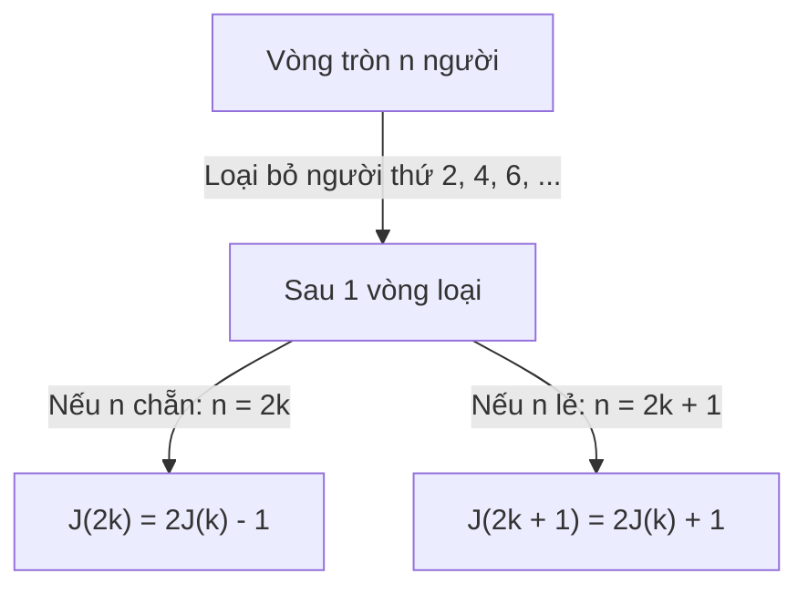

# CHUYÊN ĐỀ 04: THUẬT TOÁN GIẢM THEO TỈ LỆ HẰNG SỐ (CONSTANT-FACTOR) & LỜI GIẢI BÀI TẬP 4.4
*Tài liệu tham chiếu: A. Levitin, "Introduction to the Design and Analysis of Algorithms", 3rd Edition, Chương 4, Mục 4.4, Trang 150–157.*

---

## PHẦN I. LÝ THUYẾT VÀ MÃ GIẢ CHUẨN HÓA

Chiến lược **Giảm theo tỉ lệ hằng số (Decrease-by-a-Constant-Factor)** là một trong những kỹ thuật thiết kế thuật toán hiệu quả nhất của khoa học máy tính. Bằng cách giảm kích thước bài toán đi một thừa số cố định $b > 1$ (thường là $b = 2$ hoặc $b = 3$) sau mỗi bước, thuật toán đạt được độ phức tạp thời gian **Logarit $O(\log n)$**, tạo nên sự vượt trội hoàn toàn so với các thuật toán thời gian tuyến tính $O(n)$ hay đa thức $O(n^2)$.

---

### 1.1. Tìm kiếm nhị phân (Binary Search)

#### Bản chất ý tưởng:
- Mảng đầu vào $A[0..n-1]$ đã được sắp xếp tăng dần.
- So sánh khóa tìm kiếm $K$ với phần tử chính giữa $A[m]$ (với $m = \lfloor (l + r)/2 \rfloor$):
  - Nếu $K = A[m]$: Tìm thấy, dừng thuật toán.
  - Nếu $K < A[m]$: Khóa chỉ có thể xuất hiện ở nửa bên trái $A[l..m-1]$.
  - Nếu $K > A[m]$: Khóa chỉ có thể xuất hiện ở nửa bên phải $A[m+1..r]$.

#### Mã giả chuẩn hóa cấu trúc:

```text
Algorithm BinarySearch(A[0..n-1], K)
// Đầu vào: Mảng A[0..n-1] đã sắp xếp tăng dần và khóa cần tìm K
// Đầu ra: Chỉ số của phần tử bằng K, hoặc -1 nếu không tìm thấy

1   l ← 0; r ← n - 1
2   while l ≤ r do
3       m ← ⌊(l + r) / 2⌋
4       if K = A[m] then
5           return m        // Tìm thấy tại vị trí m
6       else if K < A[m] then
7           r ← m - 1       // Thu hẹp về nửa trái
8       else
9           l ← m + 1       // Thu hẹp về nửa phải
10  return -1               // Không tìm thấy trong mảng
```

#### Phân tích độ phức tạp:
- **Phương trình đệ quy trường hợp xấu nhất:**
  $$C_{worst}(n) = C_{worst}(\lfloor n/2 \rfloor) + 1 \quad (n > 1), \quad C_{worst}(1) = 1$$
- **Nghiệm đóng:**
  $$C_{worst}(n) = \lfloor \log_2 n \rfloor + 1 \in \Theta(\log n)$$
- **Trường hợp tốt nhất:** $\Theta(1)$ (tìm thấy ngay tại phần tử giữa $m$ ở lần lặp đầu tiên).
- **Trường hợp trung bình:** $C_{avg}(n) \approx \log_2 n - 1 \in \Theta(\log n)$.
- **Không gian bộ nhớ:** $\Theta(1)$ cho bản lặp, và $\Theta(\log n)$ cho bản đệ quy (do lưu trữ ngăn xếp gọi hàm).

---

### 1.2. Bài toán Đồng xu giả (Fake-Coin Problem)

#### Phát biểu bài toán:
Trong số $n$ đồng xu bề ngoài giống hệt nhau, có đúng **1 đồng xu giả nhẹ hơn** các đồng xu thật còn lại. Có một chiếc cân đĩa thăng bằng (không dùng quả cân). Hãy tìm đồng xu giả với số lần cân ít nhất.

#### Chiến lược Chia 3 phần (Divide-into-Three):
Thay vì chia đôi, ta chia $n$ đồng xu thành **3 phần** kích thước xấp xỉ bằng nhau:
1. Đặt hai phần có cùng kích thước $\lfloor n/3 \rfloor$ lên hai đĩa cân. Phần thứ ba để ở ngoài.
2. **Quan sát kết quả cân:**
   - Nếu cân nghiêng: Đồng xu giả nằm trong đĩa nhẹ hơn (kích thước $\lfloor n/3 \rfloor$).
   - Nếu cân thăng bằng: Đồng xu giả nằm trong phần để ở ngoài (kích thước $n - 2\lfloor n/3 \rfloor$).
3. **Phương trình số lần cân:**
   $$W(n) = W(\lceil n/3 \rceil) + 1, \quad W(1) = 0$$
   $$W(n) = \lceil \log_3 n \rceil$$
- **So sánh:** Thuật toán chia 3 cần $\lceil \log_3 n \rceil$ lần cân, trong khi thuật toán chia 2 cần $\lceil \log_2 n \rceil$ lần cân. Tỉ số cải thiện:
  $$\frac{\log_2 n}{\log_3 n} = \log_2 3 \approx 1.585 \implies \text{Nhanh hơn khoảng } 58.5\%!$$

---

### 1.3. Phép nhân nông dân Nga (Russian Peasant Multiplication)

Phương pháp nhân hai số nguyên dương $n \times m$ chỉ sử dụng các phép toán: **chia đôi (bỏ dư)**, **nhân đôi** và **phép cộng**:

$$n \times m = \begin{cases} 
\left(\frac{n}{2}\right) \times (2m) & \text{nếu } n \text{ chẵn} \\ 
\left(\frac{n - 1}{2}\right) \times (2m) + m & \text{nếu } n \text{ lẻ} \\ 
m & \text{nếu } n = 1 
\end{cases}$$

- **Mã giả thuật toán:**
```text
Algorithm RussianPeasant(n, m)
// Đầu vào: Hai số nguyên dương n và m
// Đầu ra: Tích của n và m

1   res ← 0
2   while n > 0 do
3       if n mod 2 ≠ 0 then
4           res ← res + m    // Nếu n lẻ, cộng m vào kết quả
5       n ← ⌊n / 2⌋          // Chia đôi n
6       m ← 2 * m            // Nhân đôi m
7   return res
```
- **Độ phức tạp:** Số lần lặp đúng bằng số chữ số nhị phân của $n$, tức là $\lfloor \log_2 n \rfloor + 1 \in \Theta(\log n)$.

---

### 1.4. Bài toán Josephus (The Josephus Problem)

#### Phát biểu bài toán:
$n$ người được đánh số từ $1$ đến $n$ đứng thành một vòng tròn theo chiều kim đồng hồ. Bắt đầu từ người số 1, loại bỏ người thứ 2 kề tiếp, rồi tiếp tục đếm và loại người thứ 2 tiếp theo cho đến khi chỉ còn lại đúng **1 người sống sót duy nhất**. Tìm vị trí ban đầu của người sống sót $J(n)$.



#### Hệ thức truy hồi kinh điển:
- **Trường hợp $n$ chẵn ($n = 2k$):** Sau vòng đầu tiên, toàn bộ $k$ người ở vị trí chẵn $2, 4, \dots, 2k$ bị loại. Còn lại $k$ người ở vị trí lẻ $1, 3, \dots, 2k-1$. Đổi biến vị trí ta có:
  $$J(2k) = 2J(k) - 1$$
- **Trường hợp $n$ lẻ ($n = 2k + 1$):** Sau khi loại người $2, 4, \dots, 2k$, người số 1 bị loại ngay sau người $2k$. Còn lại $k$ người bắt đầu đếm từ người số 3. Đổi biến vị trí ta có:
  $$J(2k + 1) = 2J(k) + 1$$
- **Trường hợp cơ sở:** $J(1) = 1$.

#### Công thức nghiệm đóng tuyệt đẹp:
Biểu diễn $n$ dưới dạng tổng của lũy thừa 2 lớn nhất và phần dư:
$$n = 2^m + l \quad \text{với } 0 \le l < 2^m$$
Khi đó vị trí sống sót duy nhất là:
$$J(n) = 2l + 1$$

#### Quy tắc dịch vòng 1 bit (1-bit cyclic left shift):
Nếu biểu diễn $n$ dưới dạng số nhị phân:
$$n = (1 \; b_{k-1} \; b_{k-2} \; \dots \; b_1 \; b_0)_2$$
Thì vị trí sống sót $J(n)$ thu được bằng cách **dịch vòng bit cao nhất `1` về vị trí thấp nhất bên phải**:
$$J(n) = (b_{k-1} \; b_{k-2} \; \dots \; b_1 \; b_0 \; 1)_2$$

---

## PHẦN II. GIẢI CHI TIẾT 100% CÁC BÀI TẬP EXERCISES 4.4 (BÀI 1 ĐẾN BÀI 15)

---

### Bài 1 (Cutting a stick - Cắt thanh gậy thành các đoạn 1 inch)
> **Đề bài:**  
> Một thanh gậy dài $n$ inch cần được cắt thành $n$ đoạn dài 1 inch. Hãy phác thảo một thuật toán thực hiện nhiệm vụ này với **số nhát cắt ít nhất** nếu cho phép xếp chồng các đoạn gậy lại với nhau để cắt cùng lúc. Đưa ra công thức tính số nhát cắt tối thiểu.

#### Lời giải chi tiết:
- Áp dụng chiến lược **Giảm một nửa (Decrease-by-half)**:
  - Để tối đa hóa hiệu quả của mỗi nhát cắt, ta luôn cắt tất cả các đoạn gậy hiện có **ngay tại điểm chính giữa** của chúng.
  - Sau mỗi nhát cắt, ta xếp chồng tất cả các đoạn gậy thu được lên nhau và căn chỉnh các đầu bằng nhau để chuẩn bị cho nhát cắt tiếp theo.
- **Quy trình:**
  - Nhát 1: Cắt thanh $n$ inch thành 2 thanh: $\lfloor n/2 \rfloor$ và $\lceil n/2 \rceil$.
  - Nhát 2: Xếp chồng 2 thanh lên nhau, cắt đôi tiếp $\implies$ chiều dài lớn nhất của một đoạn còn lại là $\lceil n/4 \rceil$.
  - Sau $k$ nhát cắt, chiều dài lớn nhất của đoạn gậy còn lại là $\lceil n / 2^k \rceil$.
- Thuật toán dừng khi mọi đoạn gậy đều có chiều dài bằng 1 inch, tức là:
  $$\frac{n}{2^k} \le 1 \iff 2^k \ge n \iff k \ge \log_2 n$$
- Vì số nhát cắt phải là số nguyên, số nhát cắt tối thiểu trong trường hợp xấu nhất là:
  $$C(n) = \lceil \log_2 n \rceil$$
- *Ví dụ:* Với $n = 8$ inch, cần $\lceil \log_2 8 \rceil = 3$ nhát cắt. Với $n = 10$ inch, cần $\lceil \log_2 10 \rceil = 4$ nhát cắt.

---

### Bài 2 (Decrease-by-half for $\lfloor \log_2 n \rfloor$ - Tính phần nguyên logarit cơ số 2)
> **Đề bài:**  
> Thiết kế một thuật toán giảm một nửa để tính $\lfloor \log_2 n \rfloor$ cho một số nguyên dương $n$ và xác định độ phức tạp thời gian của nó.

#### Lời giải chi tiết:
- **Ý tưởng:** Định nghĩa của $\lfloor \log_2 n \rfloor$ chính là **số lần ta có thể chia nguyên $n$ cho 2 cho đến khi giá trị chỉ còn lại 1**.
- **Mã giả:**
```text
Algorithm FloorLog2(n)
// Đầu vào: Số nguyên dương n
// Đầu ra: Giá trị ⌊log2 n⌋

1   count ← 0
2   while n > 1 do
3       n ← ⌊n / 2⌋
4       count ← count + 1
5   return count
```
- **Phân tích độ phức tạp thời gian:**
  - Vòng lặp `while` thực hiện đúng $\lfloor \log_2 n \rfloor$ lần phép chia nguyên cho 2.
  - Phép toán cơ sở: Phép chia nguyên cho 2 (hoặc phép dịch bit sang phải `n >>= 1`).
  - Số phép chia: $T(n) = \lfloor \log_2 n \rfloor \in \Theta(\log n)$.
  - Nếu tính theo kích thước biểu diễn nhị phân $b = \lfloor \log_2 n \rfloor + 1$, thuật toán chạy trong thời gian tuyến tính $\Theta(b)$ theo độ dài chuỗi bit.

---

### Bài 3 (Binary Search on 13-Element Array - Phân tích chi tiết mảng 13 phần tử)
> **Đề bài:**  
> Cho mảng đã sắp xếp gồm 13 phần tử:  
> $$A = [3, \; 14, \; 27, \; 31, \; 39, \; 42, \; 55, \; 70, \; 74, \; 81, \; 85, \; 93, \; 98]$$  
> (Chỉ số từ 0 đến 12).  
> a. Số phép so sánh khóa lớn nhất mà tìm kiếm nhị phân phải thực hiện khi tìm một khóa trong mảng này là bao nhiêu?  
> b. Liệt kê tất cả các khóa đòi hỏi số phép so sánh lớn nhất khi tìm kiếm.  
> c. Tính số phép so sánh khóa trung bình khi tìm kiếm thành công (giả sử xác suất tìm mỗi khóa là như nhau).  
> d. Tính số phép so sánh khóa trung bình khi tìm kiếm không thành công (giả sử 14 khoảng trống tạo bởi mảng có xác suất như nhau).

#### Lời giải chi tiết:

Xây dựng cây quyết định tìm kiếm nhị phân cho mảng $n = 13$ với công thức $m = \lfloor (l + r)/2 \rfloor$:
- **Tầng 1 (1 lần lặp):** $m = \lfloor (0 + 12)/2 \rfloor = 6 \implies A[6] = \mathbf{55}$.
- **Tầng 2 (2 lần lặp):**
  - Nhánh trái $A[0..5]$: $m = \lfloor (0 + 5)/2 \rfloor = 2 \implies A[2] = \mathbf{27}$.
  - Nhánh phải $A[7..12]$: $m = \lfloor (7 + 12)/2 \rfloor = 9 \implies A[9] = \mathbf{81}$.
- **Tầng 3 (3 lần lặp):**
  - Đoạn $A[0..1]$: $m = 0 \implies A[0] = \mathbf{3}$.
  - Đoạn $A[3..5]$: $m = 4 \implies A[4] = \mathbf{39}$.
  - Đoạn $A[7..8]$: $m = 7 \implies A[7] = \mathbf{74}$.
  - Đoạn $A[10..12]$: $m = 11 \implies A[11] = \mathbf{93}$.
- **Tầng 4 (4 lần lặp):**
  - Đoạn $A[1..1]$: $m = 1 \implies A[1] = \mathbf{14}$.
  - Đoạn $A[3..3]$: $m = 3 \implies A[3] = \mathbf{31}$.
  - Đoạn $A[5..5]$: $m = 5 \implies A[5] = \mathbf{42}$.
  - Đoạn $A[8..8]$: $m = 8 \implies A[8] = \mathbf{70}$.
  - Đoạn $A[10..10]$: $m = 10 \implies A[10] = \mathbf{85}$.
  - Đoạn $A[12..12]$: $m = 12 \implies A[12] = \mathbf{98}$.

#### Trả lời các câu hỏi:
- **a. Số phép so sánh khóa lớn nhất:**
  - Số lần lặp lớn nhất là độ cao của cây: $\lfloor \log_2 13 \rfloor + 1 = 4$ lần lặp.
  - Nếu tính theo thuật toán so sánh 3 nhánh chuẩn (mỗi lần lặp tốn tối đa 2 phép so sánh: `=` và `<`): Số phép so sánh khóa tối đa là:
    $$C_{worst} = 3 \times 2 + 1 = 7 \text{ phép so sánh}$$
    (Tại tầng lá chỉ cần 1 phép so sánh nếu trúng khóa). Nếu tính theo số lần lặp thì bằng **4 lần lặp**.
- **b. Các khóa đòi hỏi số lần lặp lớn nhất (ở tầng 4):**
  $$\{14, \; 31, \; 42, \; 70, \; 85, \; 98\}$$
- **c. Số lần lặp trung bình khi tìm kiếm thành công ($C_{avg}^{succ}$):**
  - 1 khóa ở tầng 1 (1 lần lặp): $\{55\}$
  - 2 khóa ở tầng 2 (2 lần lặp): $\{27, 81\}$
  - 4 khóa ở tầng 3 (3 lần lặp): $\{3, 39, 74, 93\}$
  - 6 khóa ở tầng 4 (4 lần lặp): $\{14, 31, 42, 70, 85, 98\}$
  - Tổng số lần lặp: $1 \times 1 + 2 \times 2 + 4 \times 3 + 6 \times 4 = 1 + 4 + 12 + 24 = 41$.
  - Số lần lặp trung bình:
    $$C_{avg}^{succ} = \frac{41}{13} \approx \mathbf{3.15 \text{ lần lặp}}$$
- **d. Số lần lặp trung bình khi tìm kiếm không thành công ($C_{avg}^{unsucc}$):**
  - Mảng 13 phần tử tạo thành $13 + 1 = 14$ khoảng rỗng bên ngoài/ở giữa.
  - Trong 14 khoảng rỗng này:
    - Có 2 khoảng kết thúc sau 3 lần lặp.
    - Có 12 khoảng kết thúc sau 4 lần lặp.
  - Tổng số lần lặp: $2 \times 3 + 12 \times 4 = 6 + 48 = 54$.
  - Số lần lặp trung bình không thành công:
    $$C_{avg}^{unsucc} = \frac{54}{14} \approx \mathbf{3.86 \text{ lần lặp}}$$

---

### Bài 4 (Binary Search vs Sequential Search Speedup - Tỉ số tăng tốc trên 1 triệu phần tử)
> **Đề bài:**  
> Ước tính xem một tìm kiếm thành công trung bình sẽ nhanh hơn khoảng bao nhiêu lần trong một mảng đã sắp xếp gồm **một triệu ($1,000,000$) phần tử** nếu được thực hiện bằng Tìm kiếm nhị phân so với Tìm kiếm tuần tự?

#### Lời giải chi tiết:
- Với mảng đã sắp xếp $n = 1,000,000$:
  1. **Tìm kiếm tuần tự (Sequential Search):**
     - Số phép so sánh trung bình khi tìm kiếm thành công:
       $$C_{seq} \approx \frac{n + 1}{2} \approx \frac{1,000,000}{2} = \mathbf{500,000 \text{ phép so sánh}}$$
  2. **Tìm kiếm nhị phân (Binary Search):**
     - Số lần lặp trung bình khi tìm kiếm thành công xấp xỉ:
       $$C_{bin} \approx \log_2 n - 1 = \log_2(1,000,000) - 1 \approx 19.93 - 1 \approx \mathbf{19 \text{ lần lặp}}$$
- **Tỉ số tăng tốc (Speedup factor):**
  $$\text{Tốc độ tăng} = \frac{C_{seq}}{C_{bin}} \approx \frac{500,000}{19} \approx \mathbf{26,315 \text{ lần!}}$$
- **Kết luận:** Tìm kiếm nhị phân chạy nhanh hơn tìm kiếm tuần tự **hơn 26,000 lần**!

---

### Bài 5 (Binary Search on Linked Lists - Tìm kiếm nhị phân trên danh sách liên kết)
> **Đề bài:**  
> Hiệu quả thời gian của tìm kiếm tuần tự không phụ thuộc vào việc danh sách được cài đặt bằng mảng hay danh sách liên kết. Điều này có còn đúng đối với việc tìm kiếm trên danh sách đã sắp xếp bằng tìm kiếm nhị phân không?

#### Lời giải chi tiết:
- **Trả lời:** **HOÀN TOÀN KHÔNG ĐÚNG (NOT TRUE)**.
- **Giải thích bản chất:**
  - Tìm kiếm nhị phân dựa trên tiền đề quan trọng: Ta có thể truy cập phần tử chính giữa $A[m]$ trong thời gian tức thời **$O(1)$** thông qua chỉ số mảng.
  - Trong **danh sách liên kết (Linked List)**:
    - Không hỗ trợ truy cập ngẫu nhiên qua chỉ số.
    - Để đến được nút chính giữa của một danh sách con kích thước $k$, ta buộc phải xuất phát từ đầu danh sách con và lần theo con trỏ `next` mất $k/2$ bước, tức là tốn **$\Theta(k)$ thời gian**.
  - Thiết lập phương trình đệ quy thời gian trên danh sách liên kết:
    $$T(n) = T(n/2) + c \cdot \frac{n}{2}$$
    Theo Định lý Thợ (Master Theorem) hoặc khai triển trực tiếp:
    $$T(n) = c \frac{n}{2} + c \frac{n}{4} + c \frac{n}{8} + \dots \approx c n \in \mathbf{\Theta(n)}$$
- **Kết luận:** Khi cài đặt trên danh sách liên kết, Tìm kiếm nhị phân bị **thoái hóa hoàn toàn về thời gian tuyến tính $\Theta(n)$**, mất sạch ưu thế logarit và thậm chí còn chạy chậm hơn tìm kiếm tuần tự do hệ số hằng số lớn.

---

### Bài 6 (Two-Way Comparison Binary Search - Tìm kiếm nhị phân so sánh 2 nhánh)
> **Đề bài:**  
> a. Thiết kế một phiên bản tìm kiếm nhị phân chỉ sử dụng phép so sánh hai nhánh (chẳng hạn như $\le$ và $=$ hoặc $<$ và $\ge$).  
> b. Phân tích hiệu quả thời gian của phiên bản so sánh hai nhánh này.

#### Lời giải chi tiết:

#### Phần a (Thiết kế mã giả):
Phiên bản 3 nhánh truyền thống kiểm tra 2 điều kiện: `$K = A[m]$` và `$K < A[m]$` trong mỗi vòng lặp. Phiên bản 2 nhánh chỉ thu hẹp khoảng cho đến khi đoạn còn 1 phần tử, rồi mới kiểm tra dấu bằng đúng 1 lần duy nhất:

```text
Algorithm BinarySearchTwoWay(A[0..n-1], K)
// Đầu vào: Mảng A[0..n-1] đã sắp xếp tăng dần và khóa K
// Đầu ra: Chỉ số vị trí tìm thấy hoặc -1

1   l ← 0; r ← n - 1
2   while l < r do
3       m ← ⌊(l + r) / 2⌋
4       if K ≤ A[m] then
5           r ← m        // Thu hẹp về nửa trái bao gồm cả m
6       else
7           l ← m + 1    // K chắc chắn lớn hơn A[m], tìm từ m + 1
8   if A[l] = K then
9       return l         // Kiểm tra dấu bằng duy nhất khi còn 1 phần tử
10  else
11      return -1
```

#### Phần b (Phân tích hiệu quả):
- **Ưu điểm:** Mỗi lần lặp vòng `while` chỉ thực hiện **đúng 1 phép so sánh khóa** (`K <= A[m]`) thay vì 2 phép so sánh như bản 3 nhánh. Điều này giúp mã máy của vòng lặp rất gọn và loại bỏ các bước nhảy rẽ nhánh sai (branch misprediction).
- **Số lần lặp:** Vòng lặp luôn chạy đúng $\lceil \log_2 n \rceil$ lần trong **mọi trường hợp** (không dừng sớm).
- **Tổng số phép so sánh khóa:** Đúng $\lceil \log_2 n \rceil + 1$ phép so sánh cho mọi trường hợp (tốt nhất, xấu nhất, trung bình).

---

### Bài 7 (Picture Guessing - Trò chơi đoán tranh 42 bức ảnh)
> **Đề bài:**  
> Một phiên bản giải đố phổ biến đưa ra một mảng gồm 42 bức ảnh (7 hàng $\times$ 6 cột) và yêu cầu người chơi xác định bức ảnh mục tiêu bằng cách đặt các câu hỏi chỉ được trả lời "Có" hoặc "Không". Người chơi phải tìm ra bức ảnh với số câu hỏi ít nhất có thể. Hãy đề xuất thuật toán hiệu quả nhất và chỉ ra số câu hỏi tối đa cần dùng.

#### Lời giải chi tiết:
- **Thuật toán tối ưu:** Thuật toán **Tìm kiếm nhị phân / Cây quyết định nhị phân**.
  - Mỗi câu hỏi "Có/Không" chia tập hợp các bức ảnh còn lại thành 2 phần rời nhau.
  - Để tối thiểu hóa số câu hỏi trong trường hợp xấu nhất, câu hỏi phải được thiết kế sao cho chia đôi số lượng ảnh còn lại một cách cân bằng nhất có thể (mỗi nửa 50% số ảnh).
- **Số câu hỏi tối đa cần thiết trong trường hợp xấu nhất:**
  - Với $n = 42$ bức ảnh, số câu hỏi tối đa là:
    $$Q_{max} = \lceil \log_2 42 \rceil$$
  - Vì $2^5 = 32 < 42 \le 64 = 2^6$, ta có:
    $$Q_{max} = 6 \text{ câu hỏi}$$
- **Minh họa quy trình 6 câu hỏi:**
  - Câu 1: Bức ảnh có nằm trong 3 hàng đầu tiên (21 ảnh) không? (Còn 21 ảnh).
  - Câu 2: Chia 21 thành 10 và 11 ảnh. (Còn tối đa 11 ảnh).
  - Câu 3: Chia 11 thành 5 và 6 ảnh. (Còn tối đa 6 ảnh).
  - Câu 4: Chia 6 thành 3 và 3 ảnh. (Còn 3 ảnh).
  - Câu 5: Bức ảnh có phải là ảnh A trong số 3 ảnh không? (Nếu không, còn 2 ảnh).
  - Câu 6: Bức ảnh có phải là ảnh B không? $\implies$ Xác định 100% bức ảnh duy nhất!
- **Đáp số:** Tối đa **6 câu hỏi**.

---

### Bài 8 (Ternary Search - Tìm kiếm tam phân)
> **Đề bài:**  
> Xét thuật toán tìm kiếm tam phân (Ternary Search) trên mảng đã sắp xếp $A[0..n-1]$: Nếu $n = 1$, so sánh $K$ với phần tử duy nhất. Ngược lại, so sánh $K$ với $A[\lfloor n/3 \rfloor]$, nếu $K$ lớn hơn thì so sánh tiếp với $A[\lfloor 2n/3 \rfloor]$ để xác định $K$ nằm trong phần ba nào của mảng để tiếp tục tìm kiếm đệ quy.  
> a. Thuật toán này dựa trên chiến lược thiết kế nào?  
> b. Thiết lập phương trình đệ quy tính số phép so sánh khóa trong trường hợp xấu nhất (giả sử $n = 3^k$).  
> c. Giải phương trình đệ quy trên.  
> d. So sánh hiệu quả của tìm kiếm tam phân với tìm kiếm nhị phân.

#### Lời giải chi tiết:

#### Phần a:
- Dựa trên chiến lược **Giảm theo tỉ lệ hằng số (Decrease-by-a-constant-factor)**, cụ thể là giảm theo tỉ lệ 3 (kích thước giảm từ $n$ xuống $n/3$).

#### Phần b (Phương trình đệ quy):
- Trong trường hợp xấu nhất, tại mỗi bước ta phải so sánh với cả hai mốc $A[\lfloor n/3 \rfloor]$ và $A[\lfloor 2n/3 \rfloor]$ (tốn 2 phép so sánh), sau đó bài toán quy về tìm kiếm trong đoạn kích thước $n/3$:
  $$C(n) = C(n/3) + 2 \quad (n > 1), \quad C(1) = 1$$

#### Phần c (Giải phương trình với $n = 3^k$):
- Sử dụng phương pháp thế lùi (Backward substitution):
  $$C(3^k) = C(3^{k-1}) + 2 = C(3^{k-2}) + 2 + 2 = \dots = C(3^0) + 2k = 1 + 2k$$
- Vì $k = \log_3 n$, ta có:
  $$C(n) = 2 \log_3 n + 1$$

#### Phần d (So sánh với Tìm kiếm nhị phân):
- Đổi cơ số của logarit sang cơ số 2:
  $$2 \log_3 n = 2 \cdot \frac{\log_2 n}{\log_2 3} = \frac{2}{\log_2 3} \log_2 n \approx \frac{2}{1.58496} \log_2 n \approx \mathbf{1.26188 \log_2 n}$$
- Trong khi đó, Tìm kiếm nhị phân trong trường hợp xấu nhất (bản so sánh 2 nhánh) chỉ tốn:
  $$C_{binary}(n) \approx \log_2 n$$
- **Kết luận:** Tìm kiếm tam phân thực hiện **nhiều hơn Tìm kiếm nhị phân khoảng $26.2\%$ số phép so sánh khóa**! Mặc dù chia thành 3 phần làm giảm kích thước nhanh hơn (cơ số 3), nhưng chi phí 2 phép so sánh ở mỗi bước là quá đắt, khiến tìm kiếm nhị phân vẫn vượt trội hơn.

---

### Bài 9 (Find Missing Integer in $O(\log n)$ - Tìm số nguyên bị thiếu)
> **Đề bài:**  
> Một mảng $A[0..n-2]$ chứa $n - 1$ số nguyên tăng dần trong phạm vi từ $1$ đến $n$. (Do đó có đúng một số nguyên trong khoảng này bị thiếu). Hãy thiết kế thuật toán hiệu quả nhất để tìm số nguyên bị thiếu và xác định độ phức tạp thời gian.

#### Lời giải chi tiết:
- **Quan sát mấu chốt:**
  - Nếu không có số nào bị thiếu ở phía trước chỉ số $i$, thì giá trị tại vị trí $i$ phải đúng bằng $i + 1$ (nghĩa là $A[i] = i + 1$).
  - Tại vị trí xuất hiện số bị thiếu trở đi, tất cả các phần tử đều bị dịch giá trị lớn hơn chỉ số: $A[i] = i + 2$.
  - Do đó, số bị thiếu chính là giá trị tại điểm gãy đầu tiên mà $A[i] > i + 1$!
- **Thuật toán dựa trên Tìm kiếm nhị phân:**
```text
Algorithm FindMissingNumber(A[0..n-2], n)
1   l ← 0; r ← n - 2
2   while l ≤ r do
3       m ← ⌊(l + r) / 2⌋
4       if A[m] = m + 1 then
5           l ← m + 1       // Nửa trái đầy đủ, số thiếu nằm ở nửa phải
6       else
7           r ← m - 1       // Đã lệch giá trị, số thiếu nằm ở nửa trái (kể cả m)
8   return l + 1            // l chính là giá trị bị thiếu
```
- **Độ phức tạp thời gian:** **$\Theta(\log n)$**.

---

### Bài 10 (Fake-Coin Divide-into-Three Algorithm - Thuật toán chia 3 đồng xu giả)
> **Đề bài:**  
> a. Viết mã giả cho thuật toán chia ba giải bài toán đồng xu giả xử lý đúng cho mọi giá trị $n$ (kể cả $n$ không chia hết cho 3).  
> b. Thiết lập hệ thức truy hồi cho số lần cân và giải với $n = 3^k$.  
> c. Với $n$ lớn, thuật toán này nhanh hơn thuật toán chia 2 khoảng bao nhiêu lần?

#### Lời giải chi tiết:

#### Phần a (Mã giả tổng quát):
```text
Algorithm FakeCoin3(coins[1..n])
// Tìm đồng xu giả nhẹ hơn trong n đồng xu

1   if n = 1 then
2       return coins[1]
3   p1 ← ⌈n / 3⌉; p2 ← ⌈n / 3⌉; p3 ← n - 2 * ⌈n / 3⌉
4   Đặt p1 đồng xu lên đĩa trái và p2 đồng xu lên đĩa phải
5   if Đĩa trái nhẹ hơn then
6       return FakeCoin3(phần p1)
7   else if Đĩa phải nhẹ hơn then
8       return FakeCoin3(phần p2)
9   else
10      return FakeCoin3(phần p3 để ngoài)
```

#### Phần b (Truy hồi & Giải):
- $W(n) = W(\lceil n/3 \rceil) + 1$ với $W(1) = 0$.
- Với $n = 3^k$:
  $$W(3^k) = W(3^{k-1}) + 1 = \dots = W(1) + k = k = \log_3 n$$

#### Phần c (Tỉ số tốc độ):
- Với thuật toán chia 2: $W_2(n) \approx \log_2 n$.
- Với thuật toán chia 3: $W_3(n) \approx \log_3 n$.
- Tỉ số so sánh:
  $$\frac{W_2(n)}{W_3(n)} = \frac{\log_2 n}{\log_3 n} = \log_2 3 \approx \mathbf{1.585}$$
- Thuật toán chia 3 cần ít hơn khoảng **$1.585$ lần số lần cân** so với chia 2 (tiết kiệm gần $37\%$ số lần cân).

---

### Bài 11 (Trace Russian Peasant Multiplication - Lần vết phép nhân nông dân Nga)
> **Đề bài:**  
> a. Áp dụng thuật toán nhân nông dân Nga để tính $26 \times 47$.  
> b. Xét theo hiệu quả thời gian, việc nhân $n \times m$ hay $m \times n$ có tạo ra sự khác biệt không?

#### Lời giải chi tiết:

#### Phần a: Tính $26 \times 47$
Ta lập bảng: Cột $n$ liên tục chia đôi (lấy phần nguyên), cột $m$ liên tục nhân đôi. Nếu $n$ lẻ, ta cộng giá trị $m$ tương ứng vào kết quả tích lũy:

| Bước | $n$ | $m$ | $n$ là Lẻ? | Cộng $m$ vào tích lũy |
| :---: | :---: | :---: | :---: | :--- |
| 1 | 26 | 47 | Chẵn | Không |
| 2 | 13 | 94 | **Lẻ** | $+ 94$ |
| 3 | 6 | 188 | Chẵn | Không |
| 4 | 3 | 376 | **Lẻ** | $+ 376$ |
| 5 | 1 | 752 | **Lẻ** | $+ 752$ |

- **Tổng kết quả:**
  $$\text{Tích} = 94 + 376 + 752 = \mathbf{1222}$$
- **Kiểm tra:** $26 \times 47 = 1222$ (Chính xác tuyệt đối).

#### Phần b:
- Số bước lặp của thuật toán đúng bằng $\lfloor \log_2 n \rfloor + 1$.
- Do đó, việc chọn số nào làm $n$ (số bị chia đôi) rất quan trọng:
  - Nếu chọn $n = \min(n, m)$, số lần chia đôi và số vòng lặp sẽ ít nhất!
  - Cụ thể: Với $26 \times 47$, chọn $n=26$ tốn $\lfloor \log_2 26 \rfloor + 1 = 5$ bước lặp. Nếu chọn $n=47$ tốn $\lfloor \log_2 47 \rfloor + 1 = 6$ bước lặp.
  - Vậy: **Nên đặt số nhỏ hơn ở vị trí $n$ để tối ưu hóa thời gian chạy**.

---

### Bài 12 (Pseudocode & Efficiency of Russian Peasant - Mã giả & Độ phức tạp)
> **Đề bài:**  
> a. Viết mã giả cho thuật toán nhân nông dân Nga.  
> b. Xác định lớp độ phức tạp thời gian của thuật toán này.

#### Lời giải chi tiết:
- **a. Mã giả:** Đã trình bày chuẩn hóa ở Mục 1.3 của chuyên đề này.
- **b. Độ phức tạp:**
  - Vòng lặp chạy $\lfloor \log_2 n \rfloor + 1$ lần.
  - Mỗi vòng lặp chỉ thực hiện các phép toán cơ bản trên số nguyên: kiểm tra bit lẻ, dịch phải 1 bit (`n >> 1`), dịch trái 1 bit (`m << 1`), và phép cộng `res += m`.
  - Do đó, độ phức tạp thời gian là:
    $$T(n) \in \mathbf{\Theta(\log n)}$$

---

### Bài 13 (Find $J(40)$ in Josephus Problem - Tính $J(40)$)
> **Đề bài:**  
> Tìm $J(40)$ - vị trí của người sống sót trong bài toán Josephus với $n = 40$.

#### Lời giải chi tiết:
- Phân tích $n = 40$ dưới dạng lũy thừa của 2:
  - Lũy thừa lớn nhất của 2 nhỏ hơn hoặc bằng 40 là $2^5 = 32$.
  - Ta có:
    $$40 = 2^5 + 8 \implies m = 5, \; l = 8$$
- Áp dụng công thức nghiệm đóng:
  $$J(n) = 2l + 1 \implies J(40) = 2(8) + 1 = \mathbf{17}$$
- **Cách 2 (Dịch vòng bit nhị phân):**
  - Biểu diễn nhị phân của 40: $40 = 32 + 8 = (101000)_2$.
  - Dịch vòng bit cao nhất `1` về cuối:
    $$(010001)_2 = 16 + 1 = \mathbf{17}$$.
- **Đáp số:** Vị trí số **17**.

---

### Bài 14 (Prove $J(2^k) = 1$ - Chứng minh người số 1 luôn thắng khi $n=2^k$)
> **Đề bài:**  
> Chứng minh rằng nghiệm của bài toán Josephus luôn bằng 1 với mọi $n$ là lũy thừa của 2 ($n = 2^k$).

#### Lời giải chi tiết:
- **Cách 1 (Từ công thức nghiệm đóng):**
  - Khi $n = 2^k$, phần dư $l = n - 2^k = 2^k - 2^k = 0$.
  - Áp dụng công thức $J(n) = 2l + 1$:
    $$J(2^k) = 2(0) + 1 = \mathbf{1}$$
- **Cách 2 (Quy nạp toán học theo hệ thức truy hồi):**
  - Với $k = 1$: $n = 2^1 = 2$. $J(2) = 2J(1) - 1 = 2(1) - 1 = 1$. Đúng!
  - Giả sử mệnh đề đúng với $k$, nghĩa là $J(2^k) = 1$.
  - Với $n = 2^{k+1} = 2 \cdot 2^k$ (là số chẵn): Áp dụng hệ thức truy hồi cho số chẵn $J(2m) = 2J(m) - 1$:
    $$J(2^{k+1}) = 2 J(2^k) - 1 = 2(1) - 1 = 1$$
  - Theo nguyên lý quy nạp toán học, $J(2^k) = 1$ với mọi số nguyên dương $k$.

---

### Bài 15 (Josephus Comprehensive Analysis - Phân tích toàn diện Josephus)
> **Đề bài:**  
> Đối với bài toán Josephus:  
> a. Tính $J(n)$ với $n = 1, 2, \dots, 15$.  
> b. Nhận diện quy luật trong các nghiệm từ 1 đến 15 và chứng minh tính tổng quát của nó.  
> c. Chứng minh tính đúng đắn của việc tìm $J(n)$ bằng phép dịch vòng 1 bit sang trái của biểu diễn nhị phân của $n$.

#### Lời giải chi tiết:

#### Phần a: Tính bảng giá trị $J(1)$ đến $J(15)$:

| $n$ | Biểu diễn nhị phân của $n$ | Dạng $2^m + l$ | $J(n) = 2l + 1$ | Biểu diễn nhị phân của $J(n)$ |
| :---: | :---: | :---: | :---: | :---: |
| **1** | `1` | $2^0 + 0$ | **1** | `1` |
| **2** | `10` | $2^1 + 0$ | **1** | `01` = `1` |
| **3** | `11` | $2^1 + 1$ | **3** | `11` |
| **4** | `100` | $2^2 + 0$ | **1** | `001` = `1` |
| **5** | `101` | $2^2 + 1$ | **3** | `011` = `3` |
| **6** | `110` | $2^2 + 2$ | **5** | `101` = `5` |
| **7** | `111` | $2^2 + 3$ | **7** | `111` |
| **8** | `1000` | $2^3 + 0$ | **1** | `0001` = `1` |
| **9** | `1001` | $2^3 + 1$ | **3** | `0011` = `3` |
| **10** | `1010` | $2^3 + 2$ | **5** | `0101` = `5` |
| **11** | `1011` | $2^3 + 3$ | **7** | `0111` = `7` |
| **12** | `1100` | $2^3 + 4$ | **9** | `1001` = `9` |
| **13** | `1101` | $2^3 + 5$ | **11** | `1011` = `11` |
| **14** | `1110` | $2^3 + 6$ | **13** | `1101` = `13` |
| **15** | `1111` | $2^3 + 7$ | **15** | `1111` = `15` |

#### Phần b (Nhận diện quy luật & Chứng minh):
- **Quy luật:** Dãy nghiệm $J(n)$ bắt đầu từ 1 tại mỗi lũy thừa của 2 ($n = 1, 2, 4, 8, \dots$), sau đó tăng dần theo cấp số cộng gồm các số lẻ liên tiếp ($1, 3, 5, 7, \dots$) cho đến khi chạm $2n - 1$ ngay trước lũy thừa 2 tiếp theo.
- **Chứng minh tổng quát công thức $J(2^m + l) = 2l + 1$:**
  - Quy nạp theo $m$:
    - Với $m = 1$: $n = 2$ ($l=0 \implies J(2) = 1$); $n = 3$ ($l=1 \implies J(3) = 3$). Đúng!
    - Giả sử mệnh đề đúng với $m - 1$.
    - Xét bước chuyển cho $m$:
      - Nếu $n$ chẵn: $l$ chẵn $\implies l = 2k$.
        $$n = 2^m + 2k = 2(2^{m-1} + k)$$
        Áp dụng truy hồi chẵn:
        $$J(n) = 2 J(2^{m-1} + k) - 1 = 2(2k + 1) - 1 = 4k + 1 = 2l + 1$$
      - Nếu $n$ lẻ: $l$ lẻ $\implies l = 2k + 1$.
        $$n = 2^m + 2k + 1 = 2(2^{m-1} + k) + 1$$
        Áp dụng truy hồi lẻ:
        $$J(n) = 2 J(2^{m-1} + k) + 1 = 2(2k + 1) + 1 = 4k + 3 = 2(2k + 1) + 1 = 2l + 1$$
  - Công thức được chứng minh đúng với mọi $m$ và $l$.

#### Phần c (Chứng minh tính đúng đắn của phép dịch vòng 1 bit):
- Cho $n = 2^m + l$ với $0 \le l < 2^m$.
- Biểu diễn nhị phân của $n$ có $m + 1$ bit, với bit cao nhất ở vị trí $2^m$ luôn là `1`, và $m$ bit còn lại biểu diễn giá trị của $l$:
  $$n = 1 \cdot 2^m + l = (1 \; b_{m-1} \; b_{m-2} \; \dots \; b_0)_2$$
- Thực hiện phép dịch vòng 1 bit sang trái: Bit `1` cao nhất chuyển xuống vị trí hàng đơn vị ($2^0$), và toàn bộ các bit $b_{m-1} \dots b_0$ của $l$ bị đẩy sang trái 1 vị trí (tương đương với việc nhân giá trị $l$ với 2):
  $$\text{Giá trị sau dịch bit} = (b_{m-1} \; \dots \; b_0 \; 1)_2 = 2 \cdot l + 1$$
- Giá trị này trùng khớp hoàn hảo với công thức đóng $J(n) = 2l + 1$! Phép dịch bit được chứng minh hoàn tất.
