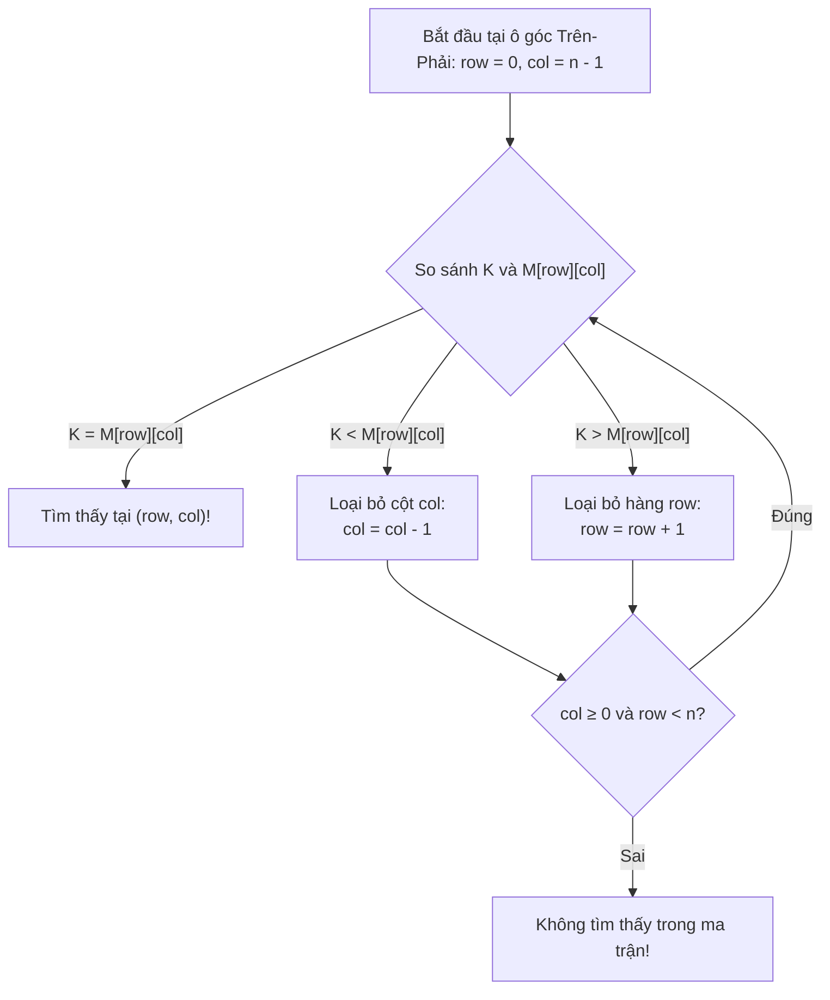

# CHUYÊN ĐỀ 05: THUẬT TOÁN GIẢM THEO KÍCH THƯỚC BIẾN THIÊN (VARIABLE-SIZE-DECREASE) & LỜI GIẢI BÀI TẬP 4.5
*Tài liệu tham chiếu: A. Levitin, "Introduction to the Design and Analysis of Algorithms", 3rd Edition, Chương 4, Mục 4.5, Trang 157–167.*

---

## PHẦN I. LÝ THUYẾT VÀ MÃ GIẢ CHUẨN HÓA

Trong biến thể thứ ba của chiến lược Giảm để trị, **mô hình thu nhỏ kích thước biến thiên linh hoạt từ bước lặp này sang bước lặp khác**, phụ thuộc hoàn toàn vào giá trị của dữ liệu đầu vào hoặc kết quả phân rã tạm thời.

---

### 1.1. Thuật toán Euclid tính ƯCLN (Góc nhìn Giảm kích thước biến thiên)
- Biểu thức: $\gcd(m, n) = \gcd(n, m \bmod n)$.
- Lượng giảm kích thước của số thứ hai $n$ sau mỗi bước là hoàn toàn không cố định: nó có thể giảm một lượng rất nhỏ hoặc giảm vọt về 0 ngay tức khắc (nếu $m$ chia hết cho $n$).

---

### 1.2. Bài toán Chọn phần tử thứ $k$ (Selection Problem) & Thuật toán Quickselect

#### Phát biểu bài toán:
Tìm phần tử nhỏ thứ $k$ ($1 \le k \le n$) trong một danh sách chưa được sắp xếp gồm $n$ phần tử. Đặc biệt, khi $k = \lceil n/2 \rceil$, bài toán trở thành **tìm Trung vị (Median)** của tập dữ liệu.

#### Cơ chế phân hoạch Lomuto (Lomuto Partition):
- Chọn phần tử đầu tiên $p = A[l]$ làm chốt (pivot).
- Dùng con trỏ $s$ ngăn cách hai vùng: vùng các phần tử $< p$ và vùng các phần tử $\ge p$.
- Quét con trỏ $i$ từ $l + 1$ đến $r$: Nếu $A[i] < p$, tăng $s$ và đổi chỗ $A[s]$ với $A[i]$.
- Cuối cùng đổi chỗ $A[l]$ với $A[s]$ để đưa chốt về đúng vị trí $s$.

```text
Algorithm LomutoPartition(A[l..r])
// Đầu vào: Mảng con A[l..r]
// Đầu ra: Vị trí chốt s sao cho A[l..s-1] < A[s] và A[s+1..r] ≥ A[s]

1   p ← A[l]
2   s ← l
3   for i ← l + 1 to r do
4       if A[i] < p then
5           s ← s + 1
6           swap(A[s], A[i])
7   swap(A[l], A[s])
8   return s
```

#### Thuật toán Quickselect (Hoare, 1961):
Sau khi phân hoạch mảng con $A[l..r]$ với chốt tại vị trí $s$:
- Nếu $s = l + k - 1$: Chốt chính là phần tử nhỏ thứ $k$, trả về $A[s]$.
- Nếu $s > l + k - 1$: Phần tử cần tìm nằm ở nửa trái $A[l..s-1]$, tìm phần tử nhỏ thứ $k$.
- Nếu $s < l + k - 1$: Phần tử cần tìm nằm ở nửa phải $A[s+1..r]$, tìm phần tử nhỏ thứ $k - (s - l + 1)$.

```text
Algorithm Quickselect(A[l..r], k)
// Đầu vào: Mảng con A[l..r] và số nguyên k (1 ≤ k ≤ r - l + 1)
// Đầu ra: Giá trị của phần tử nhỏ thứ k trong A[l..r]

1   s ← LomutoPartition(A[l..r])
2   if s = l + k - 1 then
3       return A[s]
4   else if s > l + k - 1 then
5       return Quickselect(A[l..s - 1], k)
6   else
7       return Quickselect(A[s + 1..r], k - (s - l + 1))
```

#### Phân tích độ phức tạp:
- **Trường hợp trung bình:** $T(n) = T(n/2) + \Theta(n) \implies T_{avg}(n) \in \mathbf{\Theta(n)}$ (Thời gian tuyến tính!).
- **Trường hợp xấu nhất:** Khi chốt luôn là phần tử cực trị (mảng đã sắp sẵn): $T(n) = T(n-1) + \Theta(n) \implies T_{worst}(n) \in \mathbf{\Theta(n^2)}$.

---

### 1.3. Tìm kiếm nội suy (Interpolation Search)

Dành riêng cho mảng đã sắp xếp có các giá trị **phân bố gần như đồng đều**. Thay vì chia đôi tại trung điểm, thuật toán ước lượng vị trí $x$ dựa trên nội suy tuyến tính:

$$x = l + \left\lfloor \frac{v - A[l]}{A[r] - A[l]} (r - l) \right\rfloor$$

- **Độ phức tạp thời gian:**
  - **Trường hợp trung bình:** $T_{avg}(n) \in \mathbf{\Theta(\log \log n)}$ (Cực kỳ nhanh, với $n = 10^9$ thì $\log_2 \log_2 n \approx 5$ lần lặp!).
  - **Trường hợp xấu nhất:** $T_{worst}(n) \in \mathbf{\Theta(n)}$ (Xảy ra khi dữ liệu tăng theo cấp số nhân).

---

### 1.4. Các thao tác trên Cây tìm kiếm nhị phân (BST)
- **Tìm kiếm & Chèn:** Mỗi bước đi xuống một nhánh cây con trái hoặc phải, kích thước bài toán giảm một lượng biến thiên tùy thuộc vào độ cân bằng của cây.
- **Xóa nút:** Nếu nút có 2 con, tìm phần tử kế vị (nhỏ nhất cây con phải) để thay thế rồi xóa nút kế vị.
- **Độ phức tạp:** Trung bình $\Theta(\log n)$, xấu nhất $\Theta(n)$ khi cây suy biến thành đường thẳng.

---

### 1.5. Trò chơi Nim (The Game of Nim)

#### 1.5.1. Nim 1 đống (One-pile Nim)
Có 1 đống $n$ viên sỏi. Hai người chơi lần lượt bốc từ 1 đến $m$ viên sỏi. Người bốc viên sỏi cuối cùng là người THẮNG.
- **Thế thua (Losing position) cho người đến lượt đi:**
  $$n \equiv 0 \pmod{m + 1}$$
- **Thế thắng (Winning position) cho người đến lượt đi:**
  $$n \not\equiv 0 \pmod{m + 1}$$
  *Chiến lược thắng:* Luôn bốc đúng $n \bmod (m + 1)$ viên sỏi để để lại cho đối thủ bội số của $m + 1$.

#### 1.5.2. Nim nhiều đống (Multi-pile Nim) & Định lý Bouton (1901)
Có $I$ đống sỏi với kích thước $n_1, n_2, \dots, n_I$. Mỗi lượt bốc số lượng sỏi tùy ý từ đúng một đống.
- **Tổng Nim (Nim-sum):** Phép cộng nhị phân không nhớ (chính là phép **XOR bitwise $\oplus$**):
  $$S = n_1 \oplus n_2 \oplus \dots \oplus n_I$$
- **Định lý:**
  - Một trạng thái là **Thế thắng (Winning)** $\iff S \ne 0$.
  - Một trạng thái là **Thế thua (Losing)** $\iff S = 0$.

---

## PHẦN II. GIẢI CHI TIẾT 100% CÁC BÀI TẬP EXERCISES 4.5 (BÀI 1 ĐẾN BÀI 13)

---

### Bài 1 (Size Reduction in Euclid's Algorithm - Phân tích bước giảm thuật toán Euclid)
> **Đề bài:**  
> a. Nếu đo kích thước thể hiện của bài toán tính ước số chung lớn nhất của $m$ và $n$ bằng độ lớn của số thứ hai $n$, thì kích thước này có thể giảm nhiều nhất là bao nhiêu sau một lần lặp của thuật toán Euclid?  
> b. Chứng minh rằng kích thước thể hiện sẽ luôn luôn giảm đi ít nhất một nửa sau hai lần lặp liên tiếp của thuật toán Euclid.

#### Lời giải chi tiết:

#### Phần a:
- Trong một lần lặp của thuật toán Euclid, cặp $(m, n)$ được thay thế bởi cặp $(n, m \bmod n)$. Số thứ hai mới chính là $r = m \bmod n$.
- Kích thước có thể giảm nhiều nhất: Khi $m$ chia hết cho $n$, khi đó $m \bmod n = 0$.
- Kích thước của số thứ hai giảm từ $n$ về **$0$** (nghĩa là giảm toàn bộ $100\%$, thuật toán dừng ngay lập tức).

#### Phần b (Chứng minh sau 2 bước kích thước giảm ít nhất một nửa):
- Gọi dãy các số thứ hai sau các bước lặp là $n_0, n_1, n_2, \dots$ với $n_{i+1} = n_{i-1} \bmod n_i$.
- Cần chứng minh:
  $$n_{i+2} < \frac{n_i}{2}$$
- Ta xét phép chia $n_i$ cho $n_{i+1}$:
  $$n_i = q \cdot n_{i+1} + n_{i+2} \quad \text{với } 0 \le n_{i+2} < n_{i+1}$$
  Ta phân chia thành hai trường hợp của số dư $n_{i+1}$:
  1. **Trường hợp 1: $n_{i+1} \le \frac{n_i}{2}$**  
     Vì theo định nghĩa phép chia có dư, $n_{i+2} < n_{i+1}$, nên từ $n_{i+1} \le \frac{n_i}{2}$ suy ra ngay:
     $$n_{i+2} < \frac{n_i}{2}$$
  2. **Trường hợp 2: $n_{i+1} > \frac{n_i}{2}$**  
     Vì $n_{i+1} > \frac{n_i}{2}$, số lần $n_{i+1}$ chứa trong $n_i$ chỉ có thể là thương số $q = 1$.  
     Khi đó phần dư là:
     $$n_{i+2} = n_i - 1 \cdot n_{i+1} = n_i - n_{i+1}$$
     Do $n_{i+1} > \frac{n_i}{2} \implies -n_{i+1} < -\frac{n_i}{2}$, ta có:
     $$n_{i+2} = n_i - n_{i+1} < n_i - \frac{n_i}{2} = \frac{n_i}{2}$$
- Trong cả hai trường hợp, ta đều có $n_{i+2} < \frac{n_i}{2}$.
- **Hệ quả quan trọng:** Vì sau mỗi 2 bước lặp kích thước giảm ít nhất một nửa, số lần lặp của thuật toán Euclid tối đa chỉ là $2 \log_2 n$. Đây là nền tảng chứng minh Định lý Lamé về độ phức tạp logarit của thuật toán Euclid!

---

### Bài 2 (Apply Quickselect to Find Median - Tìm trung vị bằng Quickselect)
> **Đề bài:**  
> Áp dụng thuật toán Quickselect để tìm trung vị của danh sách các số sau:  
> $$9, \; 12, \; 5, \; 17, \; 20, \; 30, \; 8$$

#### Lời giải chi tiết:
- Dãy gồm $n = 7$ phần tử. Vị trí trung vị là phần tử nhỏ thứ $k = \lceil 7/2 \rceil = 4$.
- Mảng ban đầu: $A[0..6] = [9, 12, 5, 17, 20, 30, 8]$ với $l = 0, r = 6, k = 4$.

**Đợt 1: Phân hoạch đoạn $A[0..6]$ với chốt $p = A[0] = 9$:**
- Khởi tạo $s = 0$.
- $i=1: A[1] = 12 \ge 9$ (bỏ qua).
- $i=2: A[2] = 5 < 9 \implies s = 1$, swap $A[1], A[2] \implies A = [9, 5, 12, 17, 20, 30, 8]$.
- $i=3, 4, 5: 17, 20, 30 \ge 9$ (bỏ qua).
- $i=6: A[6] = 8 < 9 \implies s = 2$, swap $A[2], A[6] \implies A = [9, 5, 8, 17, 20, 30, 12]$.
- Đổi chỗ chốt $A[0]$ với $A[s] = A[2]$:
  $$A = [8, \; 5, \; \mathbf{9}, \; 17, \; 20, \; 30, \; 12]$$
- Vị trí của chốt là $s = 2$.
- So sánh: Mục tiêu là tìm phần tử tại chỉ số $k - 1 = 4 - 1 = 3$.
- Vì $s = 2 < 3$, phần tử trung vị phải nằm ở nửa bên phải $A[3..6] = [17, 20, 30, 12]$.
- Kích thước mới: tìm phần tử nhỏ thứ $k' = 4 - (2 - 0 + 1) = 4 - 3 = 1$ trong đoạn $A[3..6]$.

**Đợt 2: Phân hoạch đoạn $A[3..6] = [17, 20, 30, 12]$ với chốt $p = A[3] = 17$:**
- Khởi tạo $s = 3$.
- $i=4: A[4] = 20 \ge 17$ (bỏ qua).
- $i=5: A[5] = 30 \ge 17$ (bỏ qua).
- $i=6: A[6] = 12 < 17 \implies s = 4$, swap $A[4], A[6] \implies A[3..6] = [17, 12, 30, 20]$.
- Đổi chỗ chốt $A[3]$ với $A[s] = A[4]$:
  $$A[3..6] = [12, \; \mathbf{17}, \; 30, \; 20]$$
- Vị trí chốt mới là $s = 4$.
- Mục tiêu tìm phần tử nhỏ thứ 1 trong đoạn $A[3..6]$, tức là tại chỉ số $3 + 1 - 1 = 3$.
- Vì $s = 4 > 3$, phần tử cần tìm nằm ở nửa bên trái của chốt, tức là đoạn $A[3..3] = [12]$.

**Đợt 3: Xét đoạn $A[3..3]$:**
- Đoạn chỉ có 1 phần tử tại chỉ số 3 là **$12$**.
- Thuật toán kết thúc và trả về giá trị **12**.
- **Kiểm tra:** Dãy sắp xếp hoàn chỉnh là $[5, 8, 9, \mathbf{12}, 17, 20, 30]$, phần tử chính giữa trung vị đúng bằng **12**. Kết quả chính xác tuyệt đối!

---

### Bài 3 (Nonrecursive Quickselect - Mã giả không đệ quy Quickselect)
> **Đề bài:**  
> Viết mã giả cho cài đặt không đệ quy của thuật toán Quickselect.

#### Lời giải chi tiết:

```text
Algorithm QuickselectNonrecursive(A[0..n-1], k)
// Tìm phần tử nhỏ thứ k không dùng đệ quy
// Đầu vào: Mảng A[0..n-1] và số nguyên k (1 ≤ k ≤ n)
// Đầu ra: Giá trị của phần tử nhỏ thứ k

1   l ← 0; r ← n - 1
2   target ← k - 1               // Chỉ số mục tiêu cần đạt
3   while l < r do
4       s ← LomutoPartition(A[l..r])
5       if s = target then
6           return A[s]          // Đã tìm thấy chốt tại đúng chỉ số mục tiêu
7       else if s > target then
8           r ← s - 1            // Thu hẹp tìm kiếm về nửa bên trái
9       else
10          l ← s + 1            // Thu hẹp tìm kiếm về nửa bên phải
11  return A[l]                  // Khi l = r, đoạn còn 1 phần tử duy nhất
```

---

### Bài 4 (Derivation of Interpolation Search Formula - Chứng minh công thức tìm kiếm nội suy)
> **Đề bài:**  
> Thiết lập công thức toán học làm cơ sở cho thuật toán tìm kiếm nội suy.

#### Lời giải chi tiết:
- Giả thiết mảng $A[l..r]$ đã sắp xếp tăng dần và các giá trị phân bố xấp xỉ tuyến tính đều đặn giữa hai điểm biên $(l, A[l])$ và $(r, A[r])$.
- Xét mặt phẳng tọa độ với trục hoành là chỉ số mảng $x$ và trục tung là giá trị phần tử $y = A[x]$.
- Hai điểm mút xác định một đoạn thẳng:
  $$P_1 = (l, A[l]) \quad \text{và} \quad P_2 = (r, A[r])$$
- Độ dốc (hệ số góc) của đường thẳng nối $P_1$ và $P_2$ là:
  $$\text{slope} = \frac{A[r] - A[l]}{r - l}$$
- Ta cần tìm chỉ số $x$ sao cho giá trị ước tính trên đường thẳng đạt đúng giá trị khóa tìm kiếm $v$:
  $$\frac{v - A[l]}{x - l} = \text{slope} = \frac{A[r] - A[l]}{r - l}$$
- Giải phương trình tìm $x$:
  $$x - l = \frac{v - A[l]}{A[r] - A[l]} (r - l)$$
  $$x = l + \frac{v - A[l]}{A[r] - A[l]} (r - l)$$
- Lấy phần nguyên để đảm bảo $x$ là chỉ số nguyên hợp lệ trong mảng:
  $$x = l + \left\lfloor \frac{v - A[l]}{A[r] - A[l]} (r - l) \right\rfloor$$
- Công thức được thiết lập hoàn tất.

---

### Bài 5 (Worst-Case Input for Interpolation Search - Trường hợp xấu nhất của tìm kiếm nội suy)
> **Đề bài:**  
> Đưa ra một ví dụ về dữ liệu đầu vào trong trường hợp xấu nhất cho tìm kiếm nội suy và chứng minh rằng thuật toán có độ phức tạp thời gian tuyến tính $\Theta(n)$ trong trường hợp này.

#### Lời giải chi tiết:
- **Nguyên nhân trường hợp xấu nhất:** Xảy ra khi phân bố giá trị bị lệch cực độ (tăng theo hàm mũ hoặc hàm lũy thừa cực nhanh), khiến công thức nội suy luôn ước lượng vị trí chốt $x$ chỉ dịch chuyển đúng **1 đơn vị** sau mỗi bước.
- **Ví dụ cụ thể:**  
  Xét mảng gồm $n$ phần tử tăng theo cấp số nhân:
  $$A[i] = 2^i \quad (i = 0, 1, \dots, n-1)$$
  Cụ thể với $n = 5$: $A = [1, 2, 4, 8, 16]$. Ta tìm kiếm khóa $K = 2$.
- **Chứng minh bước giảm chỉ bằng 1:**
  - Ở lần lặp đầu: $l = 0, r = n-1, A[l] = 1, A[r] = 2^{n-1}$.
  - Áp dụng công thức nội suy tìm $K = 2$:
    $$x = 0 + \left\lfloor \frac{2 - 1}{2^{n-1} - 1} (n - 1) \right\rfloor = \left\lfloor \frac{n - 1}{2^{n-1} - 1} \right\rfloor$$
  - Với $n \ge 4$, ta luôn có $2^{n-1} - 1 > n - 1$, do đó phân số nhỏ hơn 1:
    $$\left\lfloor \frac{n - 1}{2^{n-1} - 1} \right\rfloor = 0 \implies x = 0$$
  - So sánh: $A[0] = 1 < 2 \implies$ Cập nhật $l = x + 1 = 1$.
  - Khoảng tìm kiếm từ $n$ phần tử chỉ giảm đi đúng 1 phần tử (còn $n-1$ phần tử).
  - Quá trình này lặp lại liên tiếp: mỗi bước lặp chỉ tăng $l$ thêm đúng 1 đơn vị.
- **Tổng số bước lặp:** Thuật toán phải duyệt qua $n$ bước lặp tuần tự $\implies T(n) \in \mathbf{\Theta(n)}$.

---

### Bài 6 (Log Log Analysis - Phân tích hàm $\log_2 \log_2 n$)
> **Đề bài:**  
> a. Tìm giá trị nhỏ nhất của số nguyên dương $n$ để $\log_2 \log_2 n + 1 > 6$.  
> b. Xác định khẳng định nào sau đây là đúng:  
> i. $\log \log n \in o(\log n)$  
> ii. $\log \log n \in \Theta(\log n)$  
> iii. $\log \log n \in \Omega(\log n)$

#### Lời giải chi tiết:

#### Phần a:
- Bất phương trình:
  $$\log_2 \log_2 n + 1 > 6 \iff \log_2 \log_2 n > 5$$
- Lấy lũy thừa cơ số 2 hai vế:
  $$\log_2 n > 2^5 = 32$$
- Lấy lũy thừa cơ số 2 tiếp tục:
  $$n > 2^{32} = 4,294,967,296$$
- Vì $n$ là số nguyên dương, giá trị $n$ nhỏ nhất là:
  $$n_{min} = 2^{32} + 1 = \mathbf{4,294,967,297}$$
  *(Hơn 4.29 tỷ phần tử! Điều này cho thấy trong thực tế $\log_2 \log_2 n + 1$ hầu như không bao giờ vượt quá 6).*

#### Phần b:
- Xét giới hạn tỉ số khi $n \to \infty$ (đặt $u = \log n \to \infty$):
  $$\lim_{n \to \infty} \frac{\log \log n}{\log n} = \lim_{u \to \infty} \frac{\ln u}{u} = 0 \quad \text{(áp dụng quy tắc L'Hôpital)}$$
- Do giới hạn bằng 0:
  - **Khẳng định i: $\log \log n \in o(\log n)$ là ĐÚNG.**
  - **Khẳng định ii: $\log \log n \in \Theta(\log n)$ là SAI.**
  - **Khẳng định iii: $\log \log n \in \Omega(\log n)$ là SAI.**

---

### Bài 7 (Finding Largest Key in BST - Tìm khóa lớn nhất trên cây BST)
> **Đề bài:**  
> a. Phác thảo một thuật toán để tìm khóa lớn nhất trong một Cây tìm kiếm nhị phân (BST). Bạn có phân loại thuật toán này vào nhóm thuật toán giảm theo kích thước biến thiên không?  
> b. Lớp độ phức tạp thời gian trong trường hợp xấu nhất của thuật toán này là gì?

#### Lời giải chi tiết:

#### Phần a:
- **Nguyên lý cây BST:** Theo định nghĩa BST, mọi khóa ở cây con bên phải của nút $x$ đều lớn hơn khóa tại $x$. Do đó, khóa lớn nhất trong toàn bộ cây chắc chắn phải nằm ở nút tận cùng bên phải.
- **Mã giả thuật toán:**
```text
Algorithm BSTFindMax(root)
if root = null then return null
curr ← root
while curr.right ≠ null do
    curr ← curr.right
return curr.key
```
- **Phân loại:** **CÓ (YES)**, đây chính xác là một thuật toán Giảm theo kích thước biến thiên (Variable-size-decrease). Tại mỗi bước lặp, khi di chuyển từ `curr` sang `curr.right`, ta loại bỏ toàn bộ cây con bên trái của `curr` và chính nút `curr`. Số lượng nút bị loại bỏ biến thiên linh hoạt tùy thuộc vào hình dạng cấu trúc của cây.

#### Phần b (Độ phức tạp trường hợp xấu nhất):
- Trường hợp xấu nhất xảy ra khi cây BST bị **suy biến hoàn toàn thành một đường thẳng lệch phải** (mọi nút chỉ có con phải, không có con trái).
- Khi đó độ cao của cây là $h = n - 1$.
- Thuật toán phải duyệt qua toàn bộ $n$ nút từ gốc đến lá:
  $$T_{worst}(n) \in \mathbf{\Theta(n)}$$

---

### Bài 8 (Deleting a Key from BST - Xóa khóa khỏi cây BST)
> **Đề bài:**  
> a. Phác thảo một thuật toán để xóa một khóa khỏi Cây tìm kiếm nhị phân (BST). Bạn có phân loại thuật toán này vào nhóm thuật toán giảm theo kích thước biến thiên không?  
> b. Lớp độ phức tạp thời gian trong trường hợp xấu nhất là gì?

#### Lời giải chi tiết:

#### Phần a:
- **Thuật toán xóa nút có khóa $K$:**
  1. **Bước 1 (Tìm kiếm nút cần xóa):** So sánh $K$ với nút hiện tại, rẽ trái hoặc phải cho đến khi tìm thấy nút $Z$ có khóa $K$.
  2. **Bước 2 (Xóa nút $Z$):**
     - *Trường hợp 1 (Nút lá):* Không có con $\implies$ đơn giản xóa $Z$ và cập nhật con trỏ của cha $Z$ thành `null`.
     - *Trường hợp 2 (Nút có 1 con):* Cho nút cha của $Z$ trỏ thẳng vào nút con duy nhất của $Z$.
     - *Trường hợp 3 (Nút có 2 con):* Tìm nút kế vị $Y$ (nút có khóa nhỏ nhất trong cây con phải của $Z$). Sao chép khóa của $Y$ vào $Z$, sau đó gọi đệ quy xóa nút $Y$ khỏi cây con phải (vì $Y$ là nút nhỏ nhất cây con phải nên $Y$ chỉ có tối đa 1 con).
- **Phân loại:** **CÓ (YES)**, đây là thuật toán Giảm theo kích thước biến thiên vì cả quá trình tìm kiếm nút và tìm nút kế vị đều loại bỏ các cây con có kích thước biến thiên sau mỗi bước.

#### Phần b (Độ phức tạp trường hợp xấu nhất):
- Trường hợp xấu nhất khi cây suy biến thành danh sách liên kết có độ cao $h = n$.
- Chi phí tìm kiếm và thay thế tốn thời gian tỉ lệ thuận với độ cao:
  $$T_{worst}(n) \in \mathbf{\Theta(n)}$$

---

### Bài 9 (Hierholzer's Algorithm for Eulerian Circuit - Chu trình Euler bằng Giảm biến thiên)
> **Đề bài:**  
> Phác thảo một thuật toán giảm theo kích thước biến thiên để xây dựng chu trình Euler trong một đồ thị liên thông có tất cả các đỉnh đều có bậc chẵn.

#### Lời giải chi tiết:
Đây chính là **Thuật toán Hierholzer (1873)**:

1. **Khởi tạo:** Chọn một đỉnh xuất phát tùy ý $v_0$.
2. **Dò tìm chu trình con đầu tiên $C$:**
   - Xuất phát từ $v_0$, đi qua các cạnh chưa thăm bất kỳ.
   - Vì mọi đỉnh đều có bậc chẵn, khi đi vào một đỉnh ta luôn tìm được một cạnh chưa thăm để đi ra. Do đó, đường đi chỉ có thể kết thúc khi quay trở về chính đỉnh xuất phát $v_0$, tạo thành một **chu trình đơn $C$**.
3. **Bước Giảm kích thước biến thiên:**
   - Xóa tất cả các cạnh thuộc chu trình $C$ ra khỏi đồ thị ban đầu.
   - Đồ thị còn lại $G'$ có thể bị tách thành nhiều thành phần liên thông, nhưng **mọi đỉnh trong $G'$ vẫn duy trì bậc chẵn** (vì chu trình $C$ lấy đi đúng 2 cạnh tại mỗi đỉnh mà nó đi qua). Kích thước số cạnh của đồ thị giảm đi một lượng biến thiên $|C|$.
4. **Hợp nhất (Conquer & Merge):**
   - Duyệt dọc theo chu trình $C$, tìm đỉnh đầu tiên $u \in C$ vẫn còn cạnh chưa thăm trong $G'$.
   - Lặp lại đệ quy tìm chu trình con mới $C'$ xuất phát từ $u$.
   - Chèn chu trình con $C'$ vào vị trí của đỉnh $u$ trong chu trình $C$.
   - Lặp lại cho đến khi toàn bộ các cạnh của đồ thị đều được duyệt hết.
- **Độ phức tạp thời gian:** Đạt **$\Theta(|E|)$** (tuyến tính tối ưu) khi dùng danh sách liên kết lưu chu trình.

---

### Bài 10 (Misère One-Pile Nim - Trò chơi Nim Misère 1 đống)
> **Đề bài:**  
> Xét phiên bản Misère của trò chơi Nim 1 đống: Có 1 đống $n$ viên sỏi, mỗi lượt người chơi bốc từ 1 đến $m$ viên sỏi. Điểm khác biệt là: **Người chơi bốc viên sỏi cuối cùng là người THUA CUỘC**. Xác định các vị trí thắng và vị trí thua (cho người đến lượt đi kế tiếp).

#### Lời giải chi tiết:
- **Phân tích các giá trị nhỏ của $n$:**
  - $n = 1$: Người đến lượt đi buộc phải bốc 1 viên sỏi cuối cùng và lập tức **THUA**. Vậy $n = 1$ là **Thế thua (Losing position)**.
  - $2 \le n \le m + 1$: Người đến lượt đi có thể bốc $n - 1$ viên (số lượng này hợp lệ vì $1 \le n - 1 \le m$), để lại đúng 1 viên sỏi cho đối thủ. Đối thủ buộc phải bốc viên sỏi cuối và thua $\implies$ Các trạng thái $2 \le n \le m + 1$ là **Thế thắng (Winning position)**.
  - $n = m + 2$: Người đến lượt đi bốc bất kỳ số sỏi nào từ $1$ đến $m$ sẽ để lại cho đối thủ số sỏi nằm trong khoảng $[2, m + 1]$ (đều là thế thắng cho đối thủ) $\implies n = m + 2$ là **Thế thua (Losing position)**.
  - $m + 3 \le n \le 2m + 2$: Người chơi có thể bốc để đưa về $m + 2$ sỏi $\implies$ Thế thắng.
- **Quy luật tổng quát (Quy nạp toán học):**
  - **Thế thua (Losing position):** Khi và chỉ khi:
    $$n \equiv 1 \pmod{m + 1}$$
  - **Thế thắng (Winning position):** Khi và chỉ khi:
    $$n \not\equiv 1 \pmod{m + 1}$$
  - **Chiến lược đi thắng:**
    - Nếu $n > m + 1$: Bốc $(n - 1) \bmod (m + 1)$ viên sỏi để đưa đối thủ về trạng thái $1 \pmod{m + 1}$.
    - Khi đối thủ bị dồn về trạng thái $k \le m + 1$ sỏi ($k > 1$): Bốc đúng $k - 1$ viên sỏi để để lại đúng 1 viên duy nhất cho đối thủ.

---

### Bài 11 (Moldy Chocolate Bar - Thanh sô-cô-la có ô mốc)
> **Đề bài:**  
> Hai người chơi lần lượt bẻ một thanh sô-cô-la kích thước $m \times n$, trong đó có đúng một ô $1 \times 1$ bị mốc. Mỗi lần bẻ phải là một đường thẳng cắt ngang hoàn toàn thanh dọc theo rãnh phân chia giữa các ô. Sau mỗi lần bẻ, người vừa bẻ sẽ ăn phần sô-cô-la không chứa ô mốc. Người chơi nào bị để lại đúng ô mốc $1 \times 1$ duy nhất là người thua cuộc.  
> a. Đi trước hay đi sau có lợi thế thắng trong trò chơi này?  
> b. Thiết kế thuật toán / chương trình tương tác chơi trò chơi này.

#### Lời giải chi tiết:

#### Phần a (Quy đổi về trò chơi Nim 4 đống):
- Giả sử ô mốc nằm ở hàng $r$ ($1 \le r \le m$) và cột $c$ ($1 \le c \le n$).
- Ô mốc này phân chia thanh sô-cô-la thành 4 khoảng cách tới 4 mép biên:
  - Phía trên: $x_1 = r - 1$ hàng sô-cô-la lành.
  - Phía dưới: $x_2 = m - r$ hàng sô-cô-la lành.
  - Phía bên trái: $y_1 = c - 1$ cột sô-cô-la lành.
  - Phía bên phải: $y_2 = n - c$ cột sô-cô-la lành.
- Mỗi nước đi bẻ thanh sô-cô-la và giữ lại phần chứa ô mốc tương đương chính xác với việc: **Giảm kích thước của đúng 1 trong 4 đại lượng $x_1, x_2, y_1, y_2$ xuống một giá trị tùy ý nhỏ hơn!**
- Trò chơi kết thúc khi cả 4 giá trị đều bằng 0 ($x_1 = x_2 = y_1 = y_2 = 0$), khi đó chỉ còn lại ô mốc $1 \times 1$ và người đến lượt đi nhận ô mốc này sẽ thua.
- Đây chính là **Trò chơi Nim chuẩn gồm 4 đống** với kích thước các đống là $(r - 1, m - r, c - 1, n - c)$!
- **Chiến lược thắng & Quyền đi trước/sau:**
  - Tính tổng Nim (Nim-sum):
    $$S = (r - 1) \oplus (m - r) \oplus (c - 1) \oplus (n - c)$$
  - Nếu $S \ne 0$: Trạng thái ban đầu là **Thế thắng** $\implies$ **NGƯỜI ĐI TRƯỚC (First player) có chiến lược chắc chắn thắng**!
  - Nếu $S = 0$: Trạng thái ban đầu là **Thế thua** $\implies$ **NGƯỜI ĐI SAU (Second player) có chiến lược chắc chắn thắng**!

#### Phần b (Thiết kế chương trình tương tác):
```text
Algorithm PlayMoldyChocolate(m, n, r, c)
// Chương trình chơi sô-cô-la mốc với người dùng
1   piles ← [r - 1, m - r, c - 1, n - c]
2   while true do
3       S ← piles[0] ⊕ piles[1] ⊕ piles[2] ⊕ piles[3]
4       if S ≠ 0 then
5           // Tìm đống i sao cho piles[i] ⊕ S < piles[i] (Nước đi thắng)
6           Tìm i sao cho piles[i] ⊕ S < piles[i]
7           new_val ← piles[i] ⊕ S
8           Thực hiện bẻ mép tương ứng để giảm piles[i] xuống new_val
9       else
10          Thực hiện một nước bẻ hợp lệ bất kỳ (giảm 1 đơn vị ở đống bất kỳ > 0)
11      if piles = [0, 0, 0, 0] then
12          In "Máy tính thắng!"; return
13      Nhận nước đi bẻ sô-cô-la từ người dùng và cập nhật mảng piles
```

---

### Bài 12 (Flipping Pancakes - Bài toán Lật bánh kếp)
> **Đề bài:**  
> Có $n$ chiếc bánh kếp có kích thước đôi một khác nhau được xếp chồng lên nhau. Bạn được phép luồn một chiếc xẻng lật vào dưới một chiếc bánh bất kỳ và lật úp toàn bộ phần chồng bánh nằm phía trên chiếc xẻng. Mục tiêu là sắp xếp chồng bánh sao cho bánh to nhất nằm ở đáy, và các bánh nhỏ dần lên đỉnh. Thiết kế một thuật toán để giải câu đố này.

#### Lời giải chi tiết:
Đây là bài toán kinh điển **Pancake Sorting** (từng được Bill Gates nghiên cứu vào năm 1979). Áp dụng chiến lược **Giảm 1 (Decrease-by-one)**:

1. **Ý tưởng:** Đưa chiếc bánh lớn nhất trong phần chưa sắp xếp về đúng vị trí đáy của nó:
   - Giả sử xét chồng bánh chưa sắp xếp gồm $k$ bánh ($k$ từ $n$ giảm dần về 2).
   - **Bước 1:** Tìm vị trí $idx$ của chiếc bánh lớn nhất trong số $k$ chiếc bánh hiện tại.
   - **Bước 2 (Lật lên đỉnh):** Nếu bánh lớn nhất chưa ở đỉnh ($idx > 0$), luồn xẻng dưới chiếc bánh này tại vị trí $idx$ và lật $\implies$ Chiếc bánh lớn nhất được đưa lên **ĐỈNH** của chồng bánh (tốn 1 lần lật).
   - **Bước 3 (Lật về đáy):** Luồn xẻng dưới chiếc bánh thứ $k$ (vị trí đáy của phần chưa sắp xếp) và lật toàn bộ $k$ bánh $\implies$ Chiếc bánh lớn nhất về đúng **ĐÁY** của đoạn $k$ chiếc bánh (tốn 1 lần lật).
2. **Kích thước bài toán:** Giảm từ $k$ bánh xuống $k - 1$ bánh!
3. **Mã giả thuật toán:**
```text
Algorithm PancakeSort(P[0..n-1])
// Sắp xếp chồng bánh kích thước khác nhau
1   for k ← n down to 2 do
2       max_idx ← chỉ số của phần tử lớn nhất trong P[0..k-1]
3       if max_idx ≠ k - 1 then
4           if max_idx > 0 then
5               Flip(P, max_idx)   // Đưa bánh lớn nhất lên đỉnh
6           Flip(P, k - 1)         // Đưa bánh lớn nhất về đáy đoạn k
```
- **Số lần lật tối đa trong trường hợp xấu nhất:** Mỗi chiếc bánh cần tối đa 2 lần lật để về đúng vị trí. Với $n$ chiếc bánh, chiếc cuối cùng tự động đúng chỗ:
  $$\text{Số lần lật tối đa} = 2(n - 1) = \mathbf{2n - 2 \text{ lần lật}}$$

---

### Bài 13 (Search in Row-Column Sorted Matrix in $O(n)$ - Tìm kiếm trong ma trận hai chiều tăng dần)
> **Đề bài:**  
> Bạn cần tìm kiếm một số đã cho trong một ma trận kích thước $n \times n$, trong đó **mọi hàng và mọi cột đều được sắp xếp theo thứ tự tăng dần**. Bạn có thể thiết kế một thuật toán $O(n)$ cho bài toán này không?

#### Lời giải chi tiết:
- **Khẳng định:** Hoàn toàn làm được! Đây là thuật toán nổi tiếng **Saddleback Search** (hoặc Thuật toán tìm kiếm điểm yên ngựa).
- **Ý tưởng thiết kế (Giảm theo kích thước biến thiên / Giảm 1 hàng hoặc 1 cột):**
  - Xuất phát từ góc **Trên - Phải** của ma trận: ô $(row, col) = (0, n - 1)$.
  - Tại ô $(row, col)$, phần tử $M[row][col]$ có tính chất đặc biệt:
    - Nó là phần tử **lớn nhất** trên hàng $row$ (từ cột $0$ đến $col$).
    - Nó là phần tử **nhỏ nhất** trên cột $col$ (từ hàng $row$ đến $n-1$).
  - So sánh giá trị khóa $K$ với $M[row][col]$:
    1. Nếu $K = M[row][col]$: **Tìm thấy!** Trả về tọa độ $(row, col)$.
    2. Nếu $K < M[row][col]$: Vì $K$ nhỏ hơn phần tử nhỏ nhất của cột $col$, nên $K$ không thể xuất hiện ở bất kỳ ô nào trên cột $col$. Ta **loại bỏ toàn bộ cột $col$** $\implies col \leftarrow col - 1$.
    3. Nếu $K > M[row][col]$: Vì $K$ lớn hơn phần tử lớn nhất của hàng $row$, nên $K$ không thể xuất hiện ở bất kỳ ô nào trên hàng $row$. Ta **loại bỏ toàn bộ hàng $row$** $\implies row \leftarrow row + 1$.



#### Mã giả chuẩn hóa:
```text
Algorithm MatrixSearch(M[0..n-1, 0..n-1], K)
// Tìm kiếm khóa K trong ma trận có hàng và cột tăng dần
// Đầu vào: Ma trận M kích thước n x n và khóa K
// Đầu ra: Cặp chỉ số (row, col) hoặc thông báo không tìm thấy

1   row ← 0
2   col ← n - 1
3   while row < n and col ≥ 0 do
4       if M[row][col] = K then
5           return (row, col)
6       else if K < M[row][col] then
7           col ← col - 1     // Loại bỏ cột col
8       else
9           row ← row + 1     // Loại bỏ hàng row
10  return "Không tìm thấy"
```

#### Phân tích độ phức tạp thời gian:
- Tại mỗi lần so sánh trong vòng lặp `while`, ta hoặc giảm chỉ số cột `col` đi 1, hoặc tăng chỉ số hàng `row` lên 1.
- Chỉ số `row` chỉ có thể tăng tối đa $n$ lần (từ $0$ lên $n$).
- Chỉ số `col` chỉ có thể giảm tối đa $n$ lần (từ $n - 1$ xuống $-1$).
- Tổng số lần lặp tối đa trong trường hợp xấu nhất là:
  $$N_{steps} = n + n - 1 = 2n - 1 \text{ bước lặp}$$
- Mỗi bước lặp thực hiện số phép toán hằng số $O(1)$.
- Do đó độ phức tạp thời gian của thuật toán là:
  $$T(n) \in \mathbf{O(n)}$$
  (Nhanh hơn rất nhiều so với việc tìm kiếm nhị phân trên từng hàng tốn $O(n \log n)$).
