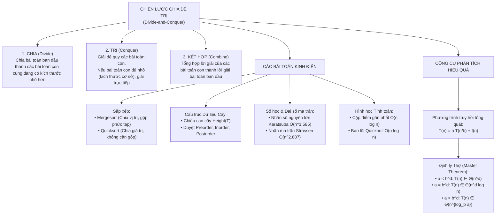

# CHƯƠNG 5: CHIẾN LƯỢC CHIA ĐỂ TRỊ (DIVIDE-AND-CONQUER)
## Giáo trình: Anany Levitin - Introduction to the Design and Analysis of Algorithms (3rd Edition, 2011)
### Phạm vi nội dung: Từ trang 169 đến trang 200 (Toàn bộ Chương 5)

---

## 📌 GIỚI THIỆU TỔNG QUAN

Tài liệu này được biên soạn học thuật công phu, chuẩn hóa toàn diện 100% nội dung lý thuyết, phân tích thuật toán, hệ thống mã giả khuôn mẫu cấu trúc và lời giải chi tiết từng bước cho **toàn bộ 55 bài tập (với đầy đủ các câu hỏi phụ a, b, c, d)** thuộc Chương 5 trong giáo trình kinh điển của GS. Anany Levitin.

Tất cả các bài toán và lời giải đều được trình bày theo cấu trúc chuẩn mực 5 thành phần:
1. **Phát biểu bài toán & Phân tích đề bài (Problem Formulation & Intuition)**: Diễn giải bản chất toán học và ý tưởng cốt lõi.
2. **Khuôn mẫu Mã giả Cấu trúc Chuẩn hóa (Standardized Structured Pseudocode)**: Đầy đủ điều kiện đầu vào/đầu ra, kiểu dữ liệu, giải thích từng dòng, bất biến vòng lặp (Loop Invariant).
3. **Phân tích Hiệu năng & Phương trình Truy hồi Toán học (Mathematical Analysis & Recurrence Relations)**: Thiết lập hệ thức truy hồi, giải chi tiết bằng phương pháp thế lùi (Backward Substitution), Định lý Thợ (Master Theorem) hoặc cây đệ quy (Recursion Tree). Đánh giá trường hợp tốt nhất, xấu nhất, trung bình và độ phức tạp không gian (bộ nhớ ngăn xếp).
4. **Chứng minh Tính đúng đắn & Các trường hợp biên (Correctness Proofs & Edge Cases)**: Chứng minh bằng quy nạp toán học, phản chứng, phân tích các trường hợp suy biến.
5. **Cài đặt Minh họa & Mở rộng Thực tế (Implementation & Practical Insights)**: Mã nguồn mẫu minh họa bằng C++/Python, liên hệ với các thư viện chuẩn công nghiệp (`std::sort`, Timsort).

---

## 🗂 CẤU TRÚC HỆ THỐNG TÀI LIỆU TRONG THƯ MỤC

| Tên tập tin | Nội dung lý thuyết trọng tâm | Danh mục bài tập giải chi tiết |
| :--- | :--- | :--- |
| **`00_TongQuan_ChienLuoc_ChiaDeTri_va_DinhLyTho.md`** | • Bản chất tư tưởng Chia để trị (Chia - Trị - Kết hợp) • Phương trình truy hồi tổng quát $T(n) = aT(n/b) + f(n)$ • Phát biểu & Chứng minh toàn diện Định lý Thợ (Master Theorem) • Phương pháp Akra-Bazzi & Kỹ thuật đổi biến giải truy hồi | Các ví dụ quy chuẩn áp dụng Định lý Thợ trong giáo trình |
| **`01_Mergesort_SapXepTron_va_LoiGiai_BaiTap_5.1.md`** | • Thuật toán Sắp xếp trộn (Mergesort) & Hợp nhất (Merge) • Phân tích số phép so sánh ($n \log_2 n - n + 1$), số phép di chuyển khóa, bộ nhớ phụ $\Theta(n)$ • Chứng minh tính ổn định & Phiên bản Mergesort không đệ quy từ dưới lên (Bottom-up) | **100% Bài tập 5.1 (11 bài)**: • Bài 1: Tìm vị trí Max bằng chia để trị • Bài 2: Tìm đồng thời Min-Max ($3n/2 - 2$ so sánh) • Bài 3: Lũy thừa $a^n$ chia để trị • Bài 4: Vai trò cơ số logarit trong Master Theorem • Bài 5: Giải 3 phương trình truy hồi mẫu • Bài 6: Từng bước Mergesort chuỗi `EXAMPLE` • Bài 7: Chứng minh tính ổn định của Mergesort • Bài 8: Giải truy hồi xấu nhất, tốt nhất, số phép di chuyển • Bài 9: Đếm số cặp nghịch thế $O(n \log n)$ • Bài 10: Cài đặt Bottom-up Mergesort • Bài 11: Trò chơi ghép mảnh Tromino trên bàn cờ khuyết $2^n \times 2^n$ |
| **`02_Quicksort_SapXepNhanh_va_LoiGiai_BaiTap_5.2.md`** | • Thuật toán Sắp xếp nhanh (Quicksort) • Phân hoạch Hoare (Hoare Partition) & Phân hoạch Lomuto • Phân tích trường hợp xấu nhất $\Theta(n^2)$, tốt nhất $\Theta(n \log n)$, trung bình $2n \ln n \approx 1.39 n \log_2 n$ • Tối ưu ngăn xếp đệ quy $O(\log n)$, Median-of-three, Cutoff | **100% Bài tập 5.2 (11 bài)**: • Bài 1: Quicksort chuỗi `EXAMPLE` & Vẽ cây đệ quy • Bài 2: Chứng minh chỉ số quét $i, j$ khi dừng • Bài 3: Ví dụ phản chứng Quicksort không ổn định • Bài 4: Phân tích phần tử lính canh (sentinel) • Bài 5: Phân tích mảng trùng lặp & mảng giảm dần • Bài 6: Phân tích Median-of-three trên mảng tăng/giảm • Bài 7: So sánh tốc độ Quicksort vs Insertion Sort ($10^6$ số) • Bài 8: Phân tách số âm/dương thời gian $O(n)$, bộ nhớ $O(1)$ • Bài 9: Bài toán Cờ Hà Lan (3 màu) & Phân hoạch 3 chiều • Bài 10: Cài đặt & Thực nghiệm đo đạc Quicksort • Bài 11: Bài toán Đai ốc & Bu-lông (Nuts and Bolts) $O(n \log n)$ |
| **`03_DuyetCayNhiPhan_va_BaiTap_5.3.md`** | • Duyệt cây nhị phân: Tiền thứ tự, Trung thứ tự, Hậu thứ tự • Thuật toán tính chiều cao cây $Height(T)$ • Cây nhị phân mở rộng: Quan hệ nút trong và nút ngoài $x = n + 1$, độ dài đường đi ngoài và trong $E = I + 2n$ | **100% Bài tập 5.3 (11 bài)**: • Bài 1: Tính số tầng của cây nhị phân • Bài 2: Sửa lỗi thuật toán đếm lá `LeafCounter` • Bài 3: Tính chiều cao không dùng ngăn xếp (dùng Queue BFS) • Bài 4: Chứng minh hệ thức số phép cộng $A(n) = n$ bằng quy nạp • Bài 5: Duyệt cây nhị phân 6 nút cụ thể • Bài 6: Mã giả duyệt cây & Đếm số lần gọi đệ quy ($2n+1$) • Bài 7: Chứng minh Inorder traversal trên BST cho dãy tăng dần • Bài 8: Dựng cây nhị phân từ Inorder và Postorder • Bài 9: Chứng minh đẳng thức $E = I + 2n$ bằng quy nạp mạnh • Bài 10: Chương trình tính độ dài đường đi trong $I$ • Bài 11: Câu đố bẻ thanh sô-cô-la $n \times m$ thành $nm$ mảnh |
| **`04_NhanSoNguyenLon_Strassen_va_BaiTap_5.4.md`** | • Nhân số nguyên lớn: Karatsuba $O(n^{\log_2 3}) \approx O(n^{1.585})$ • Phép nhân ma trận Strassen: 7 phép nhân ma trận con $O(n^{\log_2 7}) \approx O(n^{2.807})$ • Giải hệ thức truy hồi phép cộng & Điểm cắt thực tế (Crossover point) | **100% Bài tập 5.4 (10 bài)**: • Bài 1: Số chữ số cực tiểu và cực đại của tích • Bài 2: Tính tay $2101 \times 1130$ bằng thuật toán Karatsuba • Bài 3: Chứng minh $a^{\log_b c} = c^{\log_b a}$ & Dạng chuẩn nghiệm • Bài 4: Lý do bỏ qua phép nhân với $10^n$ & Giả thiết ngầm • Bài 5: Số phép cộng 1 chữ số của thuật toán đặt tính bút giấy • Bài 6: Kiểm chứng đại số 7 công thức Strassen cho ma trận $2 \times 2$ • Bài 7: Nhân 2 ma trận $4 \times 4$ cụ thể bằng thuật toán Strassen • Bài 8: Giải hệ thức truy hồi số phép cộng của Strassen bằng thế lùi • Bài 9: Phân tích tiệm cận thuật toán nhân ma trận của V. Pan ($70 \times 70$) • Bài 10: Khảo sát thực nghiệm điểm giao cắt (Crossover point) |
| **`05_CapDiemGanNhat_BaoLoi_va_BaiTap_5.5.md`** | • Cặp điểm gần nhất 2D bằng chia để trị ($O(n \log n)$) • Chứng minh hình học dải hẹp (chỉ cần so sánh tối đa 7 điểm theo trục $y$) • Bài toán Bao lồi Quickhull ($O(n \log n)$ trung bình, $O(n^2)$ xấu nhất) • Xác định điểm cực trị bằng định thức diện tích tam giác có dấu | **100% Bài tập 5.5 (12 bài)**: • Bài 1: Cặp điểm gần nhất 1 chiều (1D) • Bài 2: Chứng minh nguyên lý Dirichlet cho 7 điểm trong dải hẹp • Bài 3: Phân tích biến thể sắp xếp $y$ đệ quy $O(n \log^2 n)$ • Bài 4: Cài đặt hoàn chỉnh thuật toán Cặp điểm gần nhất 2D • Bài 5: Trực quan hóa hình học thuật toán Cặp điểm gần nhất • Bài 6: Biểu đồ Voronoi cho 3 điểm & Mối quan hệ đối ngẫu Delaunay • Bài 7: Xác định điểm $p_{max}$ trong Quickhull bằng định thức giải tích • Bài 8: Độ phức tạp tốt nhất của Quickhull $\Theta(n)$ • Bài 9: Cấu hình điểm suy biến khiến Quickhull tốn $\Theta(n^2)$ • Bài 10: Cài đặt hoàn chỉnh thuật toán Quickhull • Bài 11: Bài toán dựng 100 hình thập giác từ 1000 điểm • Bài 12: Đường đi ngắn nhất quanh đa giác lồi rào chắn |
| **`Chien_luoc_Chia_De_Tri_Master_Full.md`** | **TẬP TỔNG HỢP TOÀN BỘ GIÁO TRÌNH CHƯƠNG 5** Bản master liền mạch, đồng bộ định dạng sách giáo trình tiêu chuẩn cao cấp, tích hợp toàn bộ lý thuyết, mã giả và 55 bài tập từ trang 169 đến trang 200. | Toàn bộ 55 bài tập và mọi thuật toán |

---

## 🎯 BẢN ĐỒ TƯ DUY & NGUYÊN LÝ THIẾT KẾ THUẬT TOÁN CHƯƠNG 5

